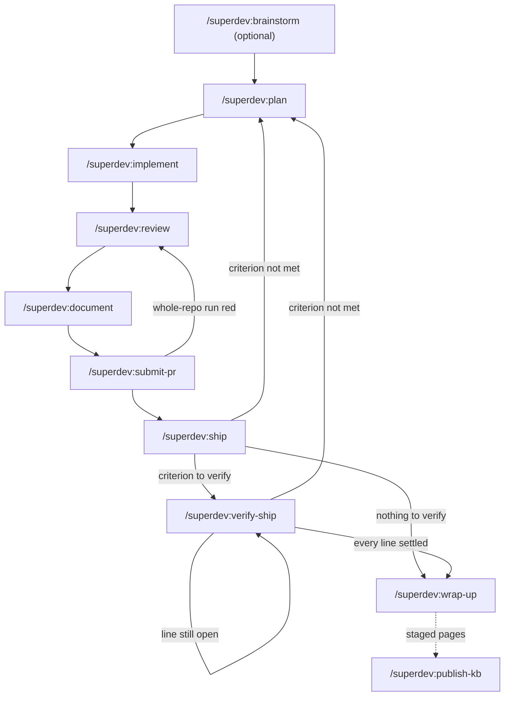
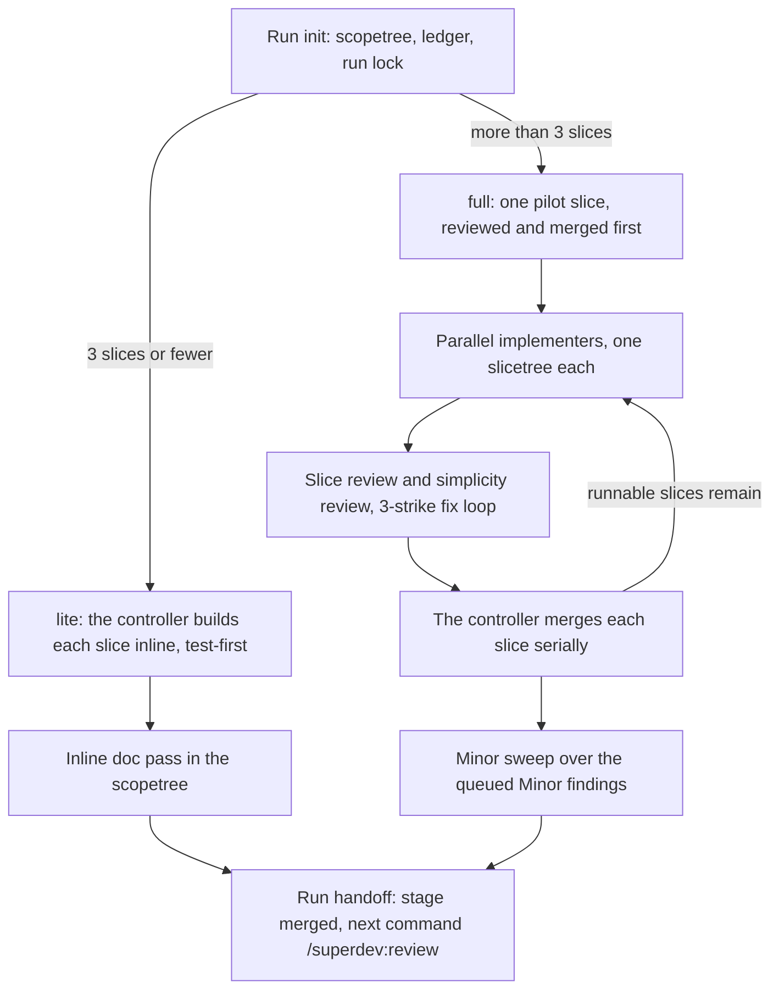

# superdev

An agent left alone will ship with confidence — whether or not anyone agreed what "done" means, whether
or not its own tests prove anything, whether or not the diff ever got a second look.

superdev makes it stop and check first.

**Before / after**

You ask your agent for a feature. Four hundred lines land across six files, the suite is green, a PR
opens. Nobody agreed what "done" meant before the first line was written, nobody but the model reviewed
it, and by the time a corner-cut surfaces, it's already merged.

With superdev: `/superdev:plan` interviews you until the Definition of Done is checkable,
`/superdev:implement` cuts the work into small slices, a separate reviewer subagent checks each one
before it merges, and the scope review runs the full suite once, after its verdict comes back clean.
superdev runs no suite on a merge, inside a scope run or outside one. A slice's tests run where the slice
is built and reviewed. The review's exit run verifies every slice and every base merge into the scope
branch together, and a red result opens a fix cycle. A gate runs the full suite only where no carried
record or recorded rerun meets it.

A self-contained Claude Code plugin for the full **brainstorm, plan, implement, review, document,
submit-pr, ship** loop, with **no prerequisite plugins**. It gives you interview-driven vertical slicing, an execution tier
sized to the plan, deterministic guardrails, and a pluggable slice store plus code host. A larger plan
runs in parallel in isolated slicetrees, with separate implementer and reviewer subagents. A small
plan runs test-first, inline in the scopetree.

```
/superdev:setup        → configure backends in docs/agents/*.md (once per repo)
/superdev:brainstorm   → (optional) turn a vague idea into a plan-ready intent
/superdev:plan         → interview + slice a feature into the slice store
/superdev:implement    → drive the slices to merge onto the scope branch, then stop
/superdev:status       → read-only: every run's progress, the slice store by what each item needs, and what to do next
/superdev:review       → whole-scope review against the DoD, with a fix loop
/superdev:document     → reconcile in-repo docs + knowledge base with the code
/superdev:submit-pr    → push the scope branch, open the PR, and leave the run standing
/superdev:ship         → merge the PR once reviewed, deploy per the repo's posture, then stop
/superdev:verify-ship  → observe the deployed system and settle the Definition-of-Done criteria the merge left open
/superdev:wrap-up      → check a shipped scope is fully settled, then close its anchor and take the run down
/superdev:publish-kb   → send a scope's staged knowledge-base pages to the configured backend
/superdev:review-tests → read-only audit of test cost and test gaps, ranked and handed to plan
/superdev:sweep        → read-only chain over code, docs, tests, and config, merged into one plan-ready intent
```

## How the commands connect

Every chain command ends its last message by naming the next command. An attended run first offers to
start that command. Each command records its progress as a stage in the run's ledger.



`/superdev:ship`, `/superdev:verify-ship`, and `/superdev:wrap-up` start only when you type the command,
ask for it, or agree to an offer. A criterion observed as not met routes to `/superdev:plan`, which plans
a `fix` feature on its own anchor. `/superdev:document` stages knowledge-base pages.
`/superdev:publish-kb` sends them when you decide the feature has reached its readers.

`/superdev:implement` derives its tier from the slice count:



| Command | Stage it writes | Tests it runs | Exits |
|---|---|---|---|
| `/superdev:brainstorm` | none. It sets the intent file to `status: ready`. | none | A draft resumes in `/superdev:brainstorm`. A ready intent goes to `/superdev:plan`. |
| `/superdev:plan` | `planned` | none | It calls `/superdev:setup` when configuration is missing. A repair choice plans a `fix` feature. |
| `/superdev:implement` | `implementing`, then `merged` | The builder of each slice runs focused tests and a fail-to-pass run. No full suite runs. | No slices go to `/superdev:plan`. The tier picks lite or full. |
| `/superdev:review` | `reviewed` | A focused run over the scope's changed paths at entry. No run inside a fix cycle. One full run after the verdict comes back clean, the scope's only full-suite run. | The fix loop stops at 3 strikes. A deferred finding becomes a triage record. |
| `/superdev:document` | `documented`, or `documented-unreviewed` before a review | none. Review's suite record carries to ship across Markdown-only doc commits. | A broken `docs` criterion writes an unresolved defect. |
| `/superdev:submit-pr` | `submitted` | The whole-repo command, when one is configured | A missing step asks once, and an unattended run refuses. A red run goes to `/superdev:review`. |
| `/superdev:ship` | `shipped` | A full run on the merged tip when the base moved. The whole-repo command on a tip without a green whole-repo record. | It refuses a tip without a reusable green suite record, and it refuses `--unattended`. It goes to `/superdev:verify-ship`, `/superdev:wrap-up`, or `/superdev:plan`. |
| `/superdev:verify-ship` | none. It ticks `dod.md` with evidence. | none. It observes the deployed system. | Every settled line goes to `/superdev:wrap-up`. A failed criterion goes to `/superdev:plan`. |
| `/superdev:wrap-up` | `closed` | none | It closes the absorbed triage records and the anchor, then removes the run. |
| `/superdev:publish-kb` | none | none | It stops twice for your answer and has no unattended mode. |

## What it does

- **`/superdev:brainstorm`** *(optional)*. A divergent discovery conversation that shapes a vague idea
  into a plan-ready intent. It explores candidate directions and offers at most the two strongest that
  survive a check against the repository. It finds the smallest end-to-end slice worth building, and
  surfaces open questions and rejected directions. It writes its intent as the interview runs, as a draft
  until the handoff, so a closed session loses nothing and a later session can resume or delete the
  draft. The handoff marks the intent ready, and `/superdev:plan` then offers it and routes each rejected
  direction to a durable home. `/superdev:plan` never offers a draft. Near read-only: it writes nothing
  to the slice store.
- **`/superdev:plan`**. A relentless interview pins the intent and a Definition of Done, and captures
  ADRs and a glossary as decisions surface. Before it asks, it checks every option against the repository
  or the official docs, shows that evidence, drops an option that fails, and offers at most two. Every
  alternative to its recommendation names what choosing it saves, or, for an option in a fixed set a
  question requires by name, states why it doesn't fit. A decision with only one defensible answer is
  stated with its reason instead of asked, and the closing summary lists it for your confirmation. A
  defect the interview finds is always fixed: the command asks only whether the fix goes into a planned
  slice, into its own slice, or into a triage record for later. Before it slices, `final-reviewer`
  derives acceptance criteria from the intent alone and the command diffs them against the drafted
  Definition of Done. The derivation starts in the background as soon as the solution shape settles and
  is handed no Definition of Done, so the interview continues while it runs (ADR 0158). The command
  settles each gap itself, as a criterion, a fold into an existing criterion, or a named non-goal, and
  shows the settlement as one proposal you confirm before slicing (ADR 0099, ADR 0122).
  It opens with one question: a new feature, an extension of an existing one, or a **repair**. A repair
  plans a `fix` feature for a shipped scope whose Definition of Done holds a criterion `/superdev:verify-ship`
  observed false. The repair has its own anchor, branch, and Definition of Done, and its anchor carries a
  `**Repairs:**` line naming the original. Nothing is written to the original, and only the original's own
  `/superdev:verify-ship` settles the failed criterion, once the repair has shipped (ADR 0124).
  Its prior-art audit also reads every open triage record and offers each match for absorption. A record
  you pick is cited by one Definition-of-Done criterion, and the scope anchor lists it on an `**Absorbs:**`
  line (ADR 0144). The derive pass reads the changed code and names its failure-mode classes, each with a
  cited file. So the Definition of Done settles a class before the first slice (ADR 0146).
  Every Definition of Done it writes
  carries a `Reachable:` criterion naming the entrance a user reaches the feature through — or `none` and
  the reason, such as no in-repo consumer or an unchanged entrance on a refactor — so a feature cannot be
  planned without deciding what wires it into the running application. It also carries `Release risk:`
  criteria for the release risks: the rollback path, data compatibility during the deploy, consumers the
  merge does not update, and the visibility of a failure on a new production path. One `Release risk:
  none` line names each risk that does not apply, with its reason. The command answers from the code where
  it can. In a repository with no recorded deploy posture, it asks once whether the feature reaches a
  running production system (ADR 0133). Before it decomposes, it offers a
  **design sketch**: a throwaway HTML page you open in your browser, inventorying the components the plan
  intends to add, change, or delete and how they interact. The command waits there, so a design you did
  not expect gets corrected while no slice has been cut yet. It then decomposes the work into
  **independently-green vertical tracer-bullet slices** with explicit `depends-on` dependencies, written
  to the configured store. On an epic whose shape earns it, the command also draws a `## Slice graph`
  (the `depends-on` DAG), a `## Touch map` (parallel-slice file collisions), or both. Both are markdown,
  both are advisory, and [`references/plan-contract.md`](plugin/references/plan-contract.md) gates each
  one. The command also tells you the execution tier `/superdev:implement` uses for the final slice count
  (see below).

  At the end of every run the command pushes the scope branch to the remote that
  `docs/agents/code-management.md` names. The plan can then be implemented on another machine or by
  another person, because `/superdev:implement` there adopts the anchor's run state and fetches the branch.
  The push overwrites a remote copy of the branch only when the base branch already holds that copy's
  content, and only through a lease on its exact tip. It refuses any other remote copy and lists its
  commits. A push that fails or is refused is reported once, with the command to run by hand, and the plan
  still finishes (ADR 0167).

  Run it again against a feature that already has slices, and it **appends**. New slices land on top of
  the ones already merged, and the command never edits, renumbers, or re-litigates any of them. An
  **anchor dependency** is a recorded relation saying this feature waits on another feature. But
  promoting a single-slice feature to an epic migrates its line onto the new epic, removing it from the
  lone record, which otherwise stays untouched. It refuses while a run against that feature is active
  elsewhere, and once that feature has **shipped** — a Definition of Done amended after the fact would
  mix criteria verified against a merged pull request with criteria nobody has verified, so follow-up
  work becomes a new feature holding an anchor dependency on the old one. It surfaces any parked questions the
  feature carries before asking anything new. A parked question is a load-bearing decision an earlier
  interview could not resolve (`references/plan-extend.md`).
- **`/superdev:implement`**. The controller drives the slices as a **dependency-ordered DAG**, sized to
  an execution tier derived fresh from the loaded slice count. The tier is never configured and never
  persisted.
  Before the first slice, every run brings the remote base into the scope branch. It fetches the base
  branch, fast-forwards your local base branch when no worktree has it checked out, merges the fetched
  tip into the scope branch whether or not the local base could advance, records that tip so review
  ranges stay limited to this scope's commits. It runs no suite. The scope review's exit run tests the merge
  with the slices. Conflicting drift since `/superdev:plan` then shows before any slice is built, not at
  `/superdev:ship`. A conflict is resolved by intent. An ADR or
  invariant number this scope added that the base already holds moves to the next free one, found by
  comparing numbers, because two ADR files with one number and different names merge without a conflict.
  `/superdev:ship` runs the same check before it merges, and stops on a collision. A base that cannot be
  fetched leaves the run on the local base, recorded as a degraded pass
  ([ADR 0120](docs/adr/0120-implement-brings-the-remote-base-into-the-scope-branch-before-the-first-slice.md)).
  With **more than 3 slices the tier is `full`**: unblocked slices run in **parallel** as `implementer`
  subagents in isolated slicetrees, with TDD and lazy minimalism. A separate **slice-reviewer**
  (correctness, settled before it reads the implementer's progress log) and, beside its first review, a
  **simplicity-reviewer** (over-engineering) gate each behavior slice. A re-review after a fix reads only
  that fix's changes, and the controller merges **serially**.
  With **3 or fewer slices the tier is `lite`**: the controller implements each slice inline and
  test-first, in a single dedicated **scopetree** (`.superdev/scopes/<scope>/scopetree/`). The
  invoking checkout is never switched, and a same-scope run lock guards against a second concurrent run.
  There are no per-slice slicetrees and no per-slice reviewers. Once every slice is merged, the controller
  also performs the documentation pass itself, in that same scopetree, as the last step before hand-off
  ([ADR 0031](docs/adr/0031-the-lite-tier-writes-its-own-documentation.md)). The `/superdev:document`
  entry below describes what that changes downstream.
  On either tier, a `behavior` slice whose commits change a test file and another file also gets a
  **fail-to-pass run**, which its implementer runs before it reports, and so does every fix cycle. The
  `scope.js fail-to-pass` verb runs the implementer's own command for the slice's test files against the changed code, then again
  with the slice's other files put back as they stood before it. The verb writes the result as an **outcome line**, a
  `fail-to-pass` line in the run trace. Tests that still pass without the change draw an
  Important **Pass-to-pass** finding, and a slice with no outcome line draws **Missing fail-to-pass run**. A run that
  cannot judge records `unknown`, which draws no finding
  ([ADR 0134](docs/adr/0134-a-fail-to-pass-run-shows-a-change-s-tests-discriminate.md),
  [ADR 0182](docs/adr/0182-the-implementer-proves-its-change-and-the-controller-runs-only-suite-gates.md)).
  Implement runs no full suite, and no reviewer runs a test. A failing test a slice did not cause is
  named in the report and goes to the scope review's fix loop
  ([ADR 0191](docs/adr/0191-the-full-suite-runs-once-after-review-comes-back-clean.md)).
  Either tier stops here, once every slice sits on the scope branch. `/superdev:review` runs next: one
  **whole-scope review** that gates the pull request `/superdev:submit-pr` opens later.
- **`/superdev:status`**. One read-only report of where the work stands and what to do next. It prints
  every run's ledger first: per scope, the slice counts by status, which slices are `blocked`, and each
  scope holding **staged** knowledge-base pages, so a page nobody published yet stays visible instead of
  silent. Then it surveys the **slice store**. It groups every open scope anchor, every triage record,
  every stranded run root, and every **untriaged item** — an open record you filed and no `/superdev:plan`
  interview has yet reached — by the action it needs — running in another session, blocked, stranded, in
  flight, running on another machine, waiting on another feature, needing a plan, unreleased, untriaged,
  absorbed by an open scope, likely resolved by a closed one, or ready to build — and ends with one recommended next move. A run another session is working, whose ledger
  names a step and whose run lock is under an hour old, shows as running and is never the recommended move
  ([ADR 0163](docs/adr/0163-status-carries-the-backlog-survey.md)). Untriaged items are capped at 5, oldest
  first, so a store with real reporters doesn't drown the rest of the table. A slice store that is
  unconfigured or fails to answer gets one line after the ledger, never an empty table. The survey resolves
  an ambiguity toward showing the row, because it reports rather than acts
  ([ADR 0049](docs/adr/0049-an-advisory-survey-judges-the-backlog-more-loosely-than-an-actor.md)).
  `/superdev:status <scope> --trace` prints that scope's run trace as a timeline instead, and
  `--slice <id>` narrows it to one slice. It sits outside the implement chain, and never writes,
  transitions, or merges anything.
- **`/superdev:review`**. Two modes. Given an ad-hoc diff, branch, path, or the working tree, it needs no
  plan and no slice store, and it stays read-only end to end. A path whose diff is empty — an area you
  never changed — is reviewed as **standing code**, the files under it at `HEAD`, so pointing a review at
  an existing module or test tree reports findings rather than an empty range (ADR 0063). Given a live
  scope branch, or a bare invocation on a clean checkout that finds one run in progress, it is the
  whole-scope review gate in the implement chain: it checks the scope against that run's `dod.md`, and it
  can drive one fix loop after asking once. Several runs in progress get listed for you to pick; naming a
  scope by its slug works too (ADR 0078). With no argument, or with `.` at the repository root, review
  reads the first subject it finds: uncommitted changes, then the branch's commits ahead of base, then a
  run waiting for review, then the whole repository as standing code. Before that last step it lists
  every run with its stage, so you see a run you meant to name (ADR 0165). An argument that names
  nothing it can resolve, a path outside the checkout, or a ref that is no commit stops with the argument
  named. The fix loop fixes every finding, Minor ones included, for at most
  three cycles, and only a Critical or Important finding left at the cap holds the run (ADR 0098). A
  re-review that leaves only Minor prompt-concept overlap findings and no broken criterion ends the loop
  early (ADR 0170). The fix loop
  changes how the code meets the Definition of Done; a case in an existing test suite, a case or row for
  an existing drift check, or a prose fix that makes text agree with an existing rule stays in the loop
  (ADR 0097). A
  finding whose remedy would add a capability nobody planned goes to `/superdev:plan` instead of growing
  the scope under review (ADR 0035). Such a finding gets a
  **triage record** in your slice store as the review defers it: an issue carrying a `triage` label.
  The record reaches your backlog, not just the run's ledger and the pull-request body, both of which
  end with the run, whether or not the scope ever ships
  ([ADR 0046](docs/adr/0046-a-deferred-finding-becomes-a-triage-record.md)). Nothing ever builds
  it: no candidate listing and no slice loader selects it. A later review in the same run can name a
  cheaper remedy for it, such as a new test case. The run then fixes it after all,
  removes the ledger bullet, and closes the record
  ([ADR 0121](docs/adr/0121-a-run-resolves-a-deferred-finding-it-later-fixes.md)). It closes only a record
  its own run filed that no open anchor absorbs. Every writer of a triage record reads the open records
  first and comments on a record that plainly states the same defect. It files no second record
  ([ADR 0145](docs/adr/0145-a-triage-write-comments-on-a-matching-open-record.md)). A real defect the run meets that no slice
  covers, and that the scope did not cause, earns the same kind of record. A flaky test in untouched
  code is an example. Whichever chain command meets
  it writes the record then, never at a handoff, and `/superdev:plan` writes one when you place a found
  defect for later
  ([ADR 0088](docs/adr/0088-an-observation-is-recorded-where-it-is-met.md)). Either way the command
  dispatches `final-reviewer`, plus `simplicity-reviewer` on the `lite` tier. The `full` tier already
  ran that reviewer per slice, so the whole-scope pass skips it rather than re-reading cut-down code
  ([ADR 0037](docs/adr/0037-the-full-tier-skips-the-whole-scope-over-engineering-pass.md)). It reports
  one consolidated verdict.
- **`/superdev:document`**. Dispatches the `doc-writer` to reconcile the in-repo docs (the `AGENTS.md`
  hierarchy) and the optional knowledge base with the current code. It adds what is new and **removes
  stale or obsolete** text. For a remote knowledge-base backend it writes each page as a **staged page**
  instead of sending it. `/superdev:publish-kb` sends it later, once a human decides the feature has
  reached its readers ([ADR 0023](docs/adr/0023-the-knowledge-base-publish-is-its-own-command.md)). It
  then reader-tests the result: the fresh-context `doc-reader` reads the
  changed docs cold and verifies their claims against the repo. Ungrounded or stale text goes back to
  the `doc-writer` for one fix round. **On a `lite` scope that already documented itself inline**
  ([ADR 0031](docs/adr/0031-the-lite-tier-writes-its-own-documentation.md)), it dispatches no `doc-writer`.
  It dispatches only the `doc-reader`, over the doc files that run's own commits touched, and nothing
  when those commits touched none. A review fix loop that lands commits clears that record. The next run of this command then
  dispatches the writer again. Both agents also apply a **content-type lens**
  ([`references/content-types.md`](plugin/references/content-types.md)): does a reader learn *why* a thing
  exists and *when* to use it, not only what it is called and how to run it. That check is always on,
  unlike the **writing standard**, which the repo may configure to `none`. Where a writing standard is
  configured, the `doc-writer` writes to it and the `doc-reader` verifies it. It is the third command of the
  four-command chain, run over the range `/superdev:review` hands it, and it also runs on demand at any
  time. On demand it does a full reconcile, a reconcile scoped to a range or area, or an `audit` for a
  reader-first check.
  Called empty on a **brownfield repo with no `AGENTS.md` hierarchy**, it **bootstraps** one instead. It
  seeds a root `AGENTS.md`, child files where they are warranted, and a proposed `CONTEXT.md` glossary,
  all from the existing code. It confirms them with you before anything commits.
- **`/superdev:setup`**. Records the backends in `docs/agents/*.md`, so the workflow never hardcodes a
  tool. For a knowledge base it also captures the **audiences** and the **language**, and proposes a
  human-first outline. It asks which **writing standard** the doc agents write to. When it finds no
  `AGENTS.md` hierarchy in the repo, it points you at `/superdev:document`'s bootstrap mode to seed one.
  On a configured repo, a plain re-run offers each **seed gap**, and `check` lists them.
- **`/superdev:publish-kb`** *(remote knowledge base only)*. Sends a scope's **staged** knowledge-base
  pages to the configured backend, and is the only path from superdev to one. `/superdev:plan` and
  `/superdev:document` write a remote backend's pages under `.superdev/kb-pending/<scope>/` in the main
  working tree, whichever checkout they run in, instead of sending them
  ([ADR 0119](docs/adr/0119-a-staged-page-lives-in-the-main-working-tree.md)). A page sent from unmerged or unreleased work claims a feature no reader can reach
  ([ADR 0023](docs/adr/0023-the-knowledge-base-publish-is-its-own-command.md)). You decide when to run
  it: it warns once when the base branch does not already hold the scope branch's work, but a merge is
  not a release, so it never blocks on that check. On a wiki that nests no pages, a knowledge base
  declaring `- **Hierarchy:** links` has each published page linked from a list item in its parent's
  body: publish-kb adds that line once, and a delete removes it
  ([ADR 0168](docs/adr/0168-a-flat-wikis-hierarchy-is-its-parents-links-edited-live-by-publish-kb.md)).
  A page whose link did not land is reported `not linked` and stays staged. Every backend command
  runs under a 30-second bound, and a command that exhausts it **stops the run** — a host that stops
  answering one call stops answering the next, so the remaining pages are reported untried and stay
  staged for a later run
  ([ADR 0130](docs/adr/0130-a-backend-command-runs-under-a-time-bound.md)).
- **`/superdev:review-tests`**. Audits what the test suite costs and what it leaves untested. The cost
  audit sweeps the whole test tree in one pass, runs the repo's optional **timing command** to measure
  it, and reports redundant coverage, overweight fixtures, tautological tests, dead tests, and expensive
  tests, ranked by measured duration — or labelled `unmeasured` and ranked by judgment where no timing
  command is configured ([ADR 0066](docs/adr/0066-a-measured-test-audit-is-its-own-surface.md)). The gap
  audit reads every tracked code file outside the test paths, in directory batches, and reports each
  symbol no test reaches (`untested`) and each case its tests leave out (`missing case`), ranked trust
  boundary first, then exported, then internal. No coverage tool runs, so every gap finding is labelled
  `static` ([ADR 0162](docs/adr/0162-a-test-audit-also-finds-test-gaps.md)). Every finding is a judgment
  you can reject before it survives. Its only writes are the intent for `/superdev:plan` and the
  one-line `.gitignore` entry that keeps its scratch directory ignored when absent.
- **`/superdev:sweep`**. Chains `/superdev:review`, `/superdev:document audit`, `/superdev:review-tests`,
  and `/superdev:setup check` over a whole repository (or the path you give it) into one merged, ranked
  report, each finding attributed to the leg that found it. Every leg runs read-only, in a **chained
  posture**: the doc and test legs return findings instead of repairing or asking on their own
  ([ADR 0068](docs/adr/0068-a-repository-sweep-chains-the-read-only-surfaces.md)). A checkable fact — a
  grounded doc claim, a config drift verdict, a dead or ignored test — reaches the intent directly; every
  other finding is a judgment you confirm or reject in one `AskUserQuestion` round. Its only write is the
  intent for `/superdev:plan`.

## After the PR

`/superdev:implement` is a goal-based loop. It drives the DAG until every slice sits on the scope branch,
then **stops**. `/superdev:review`, `/superdev:document`, and `/superdev:submit-pr` run next, in that
order, and carry the run the rest of the way to a pull request. The last mile, once the PR is open, is a
time-based loop, so hand review comments and CI on it to `/loop`:

```
/loop 5m check my PR, address review comments, and fix failing CI
```

Every command in the chain ends an attended run by asking whether to start its next command (ADR 0157).
`/superdev:brainstorm`, `/superdev:sweep`, and `/superdev:review-tests` do the same. In the Claude desktop app,
the recommended answer is **Start in a new session**: it puts up a New task card, and a click on it starts the next
command in a new session with a fresh context, in the same checkout, with the arguments the command would print
(ADR 0176, ADR 0183). **Start** runs it in the same
conversation, with the same arguments. **Stop here** prints the command instead, and it is the recommended answer
in the CLI. Run `/clear` and type it for a fresh context, because a command started in place reads the whole conversation.
A started command keeps every check and every question it has when typed. An unattended run, a blocked stop,
and a stop that waits on an action of yours ask nothing.

`/superdev:submit-pr` offers `/superdev:ship`. The pull request is not reviewed yet at that point, and **Start**
merges it now, exactly as typing `/superdev:ship` does, so review it first and answer then. Ship, verify-ship,
and wrap-up started in a new session by the offer ask once more before they act. The host's
approvals and branch protection still apply. `/superdev:ship` merges the pull request and deploys the merge under
the repository's deploy posture (`none`/`manual`/`auto`, `docs/agents/deployment.md`, ADR 0101). Ship then offers once to start the
next command and prints it when the operator does not take the offer. Ship prints the Next block on a decline and on every route that gets no offer. A run that routes to repair or re-verify, waits on a deploy, or waits on a hand-sync gets
no offer. `/superdev:verify-ship` settles the criteria only a deployed system can show, and offers
`/superdev:wrap-up` once every criterion is settled. `/superdev:wrap-up` closes the scope anchor and cleans up
the run. `/superdev:ship`, `/superdev:verify-ship`, and `/superdev:wrap-up` start only when the operator typed
the command, asked for it, or agreed to an offer. Ship refuses `--unattended` (ADR 0157). Ship names `/superdev:verify-ship` next while
a criterion is open or a `manual` deploy waits for an answer, and `/superdev:wrap-up` otherwise (ADR 0116).
A criterion `/superdev:verify-ship` observes false keeps the anchor open. Verify-ship then names
`/superdev:plan`'s repair choice, or itself again for an observation that was transient. A run whose
`not met:` notes were all written before merge ends on `/superdev:verify-ship` again, also after the operator
defers such a line, because nothing has observed that line yet. When a repair
closes, its `/superdev:wrap-up` names the original's next command (ADR 0124).
When staged knowledge-base pages wait, all three name their count and directory, state that wrap-up keeps
them, and name `/superdev:publish-kb` on the Next block's `Or:` line. `/superdev:wrap-up` refuses to close a run while its scopetree or a
slicetree still holds a staged file, because removing that checkout deletes the file (ADR 0119).

Any chain command (`/superdev:implement`, `/superdev:review`, `/superdev:document`, `/superdev:submit-pr`)
takes `--unattended`. At a stop, the run takes the stop's standing answer, or blocks the scope anchor
instead of asking. Whoever invokes the command passes the token, and superdev ships no driver.
`/superdev:ship` has no unattended mode.

To cap a long `/superdev:implement` run, wrap the call in `/goal`. Give it the Definition of Done as the
stop condition and an explicit turn ceiling (for example, "stop after N tries").

## Roles (subagents)

The subagents are `implementer`, `slice-reviewer`, `simplicity-reviewer`, `final-reviewer`,
`doc-writer`, `doc-reader`, `test-auditor`, and `test-gap-auditor`. Each runs in an isolated context, and only its result
returns to the controller.

The **full** execution tier dispatches `implementer`, `slice-reviewer`, and `simplicity-reviewer` per
slice. The **lite** tier (3 slices or fewer) has the controller implement inline instead, and also
performs the documentation pass itself, as the last step before hand-off (ADR 0031). Both tiers hand
off to the same chain once every slice sits on the scope branch: `/superdev:review` dispatches
`final-reviewer` over the whole scope, plus `simplicity-reviewer` too on the `lite` tier. The `full`
tier already ran that reviewer per slice, so the whole-scope pass skips it
([ADR 0037](docs/adr/0037-the-full-tier-skips-the-whole-scope-over-engineering-pass.md)). Then
`/superdev:document` dispatches
`doc-writer` to reconcile the docs, reader-tested by `doc-reader`. On a `lite` scope that already
documented itself, it dispatches `doc-reader` alone instead. The doc reconcile always runs **after**
the review, and never concurrent with it, so the `doc-writer`'s commits cannot shift the diff the reviewer
read ([ADR 0003](docs/adr/0003-doc-reconcile-runs-serially.md)).

## Guardrails (deterministic hooks)

The hooks are cross-platform Node. They need `node` on PATH (see [Install](#install)), so there are no
bash or PowerShell variants.

- **merge-guard.** Blocks `git merge`, `git push`, `git rebase`, `git pull`, `git subtree push`, `scope.js push`, a git
  alias defined inline that runs one of them (`git -c alias.p=push p`, its value split with quotes and backslashes as git
  splits it, read past git's global options, and followed through a chain of inline aliases, an alias a value defines included;
  a `!` value is read as a shell command line with the arguments git appends to it, each one a single quoted word as git's `"$@"` passes it), one of them typed under an inline alias of its own name, which git ignores
  (`git -c alias.merge=log merge x`), `gh pr merge`, `tea pr merge` (or tea's
  `pulls merge` and `pull merge`, and its `m` alias), with options before `pr` and `merge` read past, and a
  `tea api` POST or `gh api` PUT or POST to a pull request's `/merge` endpoint from inside a subagent,
  scoped by `agent_id`. It blocks each of these behind an `rtk` prefix too, with or without one of rtk's run-anything
  subcommands (`proxy`, `err`, `run`, `summary`, `test`) after it, its `--` separator, or a second `rtk` (#958). A `curl` call to the
  `/merge` endpoint stays a prose contract the subagent bodies carry. The guard reads the command with one
  shared shell scanner (ADR 0135): every command it holds, at every level, past `NAME=value` words and
  prefix wrappers such as `env`, `sudo`, `nohup`, `xargs`, `exec`, `eval`, `flock`, and `taskset`, each with its options and the
  values they take (`env -P /usr/bin git push`). It reads the text of every
  quoted or backslash-escaped word as a command line too, so `sh -c "git merge x"`, `dash -c git\ push`, and
  `ssh host "gh pr merge 1"` are blocked. The scan re-reads a backslash-escaped word as a command line only when a character it escapes is whitespace, an operator (a parenthesis included), a backtick, or a `$`. It also reads the command, and every quoted text it reads as a command line, as
  dash reads it, where `((…))` runs nested subshells, so `dash -c "((git push))"` is blocked.
  It blocks any heredoc body or here-string whose text names one of these, whatever command receives it
  (`cat <<E`, `cat <<E | sh`, `cat <<E > >(sh)`, `ssh host <<E`). Two receivers are exempt when the command stands
  alone on the line, behind no wrapper, with no pipe after it, and with no substitution, subshell, function body, group,
  or compound command around it. The first is a file sink: `cat`, or `tee` with at most `-a`, whose output goes only to
  plain files, such as `cat >> progress.md <<'E'`. The second is a message sink: `git commit -F -`,
  `gh pr|issue … --body-file -`, or `tea issue|issues|pull|pulls|pr … --description-file -`, that opens no editor on its text:
  a git commit with `-e`, `--edit`, or a `-c` or `--config-env` setting of `core.editor` or `sequence.editor`, and a `gh`
  command with `-e` or `--editor`, are no sinks. A plain file is a path with no expansion and
  no process substitution, under neither `/dev/` nor `/proc/`, with `/dev/null` allowed. A line that runs `exec`
  exempts neither receiver. A sink's body is still blocked where the base hook blocked it: a line or `;`, `&`, `|` segment
  that starts with `git` and later names a guarded verb, a line that starts with `gh pr merge` or `tea pr merge`, and an
  API merge call. It reads the text an `echo` or `printf` writes as a
  command line when a known shell reads it on stdin (`echo git push | sh`), also through `xargs sh -c` or an alias or a
  function that runs a shell. The contents of a file piped to a shell stay unread. A git, `gh`, or `tea` command behind
  `xargs` that stops before its verb is blocked, because `xargs` takes the verb from stdin.
  Any quoted word, and any heredoc body or here-string no sink receives, whose text names one of these is blocked as well,
  a known false positive: a grep pattern (`grep -rn "git merge" docs/`), a commit message
  (`git commit -m "git push fails behind rtk"`), or a pull request body passed as a quoted word. A command the scanner cannot read to its end, and a quoted text that does not read as a
  command line (a commit message with a parenthesis or an apostrophe), is blocked only when its raw text
  holds the word `git` and, later, `merge`, `push`, `rebase`, or `pull`, or the word `gh` or `tea` and, later,
  `pr merge`, `pulls merge`, or `pull merge`, or the word `scope.js` and, later, `push`. A scanner that cannot load blocks the call and names the broken install. The controller
  integrates.
- **model-explicit.** Blocks a dispatch to a superdev subagent that omits an explicit `model`, so cost
  is always warrant-scaled.
- **run-lock.** Blocks a `git worktree add` on a scopetree (`.superdev/scopes/<scope>/scopetree`)
  while a fresh `.superdev/scopes/<scope>/run.lock` exists, so two concurrent lite runs on one scope
  cannot collide. The hook looks for the lock in the run root the command names. It also checks the
  run root under the session's working directory, as a backstop for a path the hook cannot expand
  (triage #910). A stale lock (older than the staleness threshold) or no lock at all passes through,
  which covers a crash resume and a new run.
- **ledger-guard.** Blocks the direct write shapes to a scope's `ledger.md`: an `Edit`, a `Write`, and a
  `Bash` write (a redirect, `<>` included, `tee`, `sed -i`, `cp`, `mv`, `install`, `ln`, `patch`, `rsync`, a `vim -es` script,
  `curl -o`, `wget -O`, `ditto`, `xxd`, `tar -x`, or a recursive copy or extraction into a run root) are all denied. An interpreter
  (`python`, `node`, `perl`, `ruby`) whose inline script names a ledger is denied too, a read included,
  because only the language's own parser could tell the two apart; `cat <> L` is denied as well, a fail-closed false
  positive. An interpreter that reads its script from a heredoc or here-string naming a ledger is denied too. An
  interpreter whose script operand names a script file, such as `node scope.js deferred add - <<'E'`, reads that stdin as data.
  The script operand is the first word past every option and option value (`node -r ./a.js`, `ruby -I ./lib`), and `-`,
  `/dev/stdin`, `/dev/fd/0`, and `/proc/self/fd/0` name stdin, not a script file, and an operand holding no `.` or `/` is no script
  file either. The interpreters that read stdin are `python` (with optional digits and dots, `python3.11`), `node`, `perl`, and
  `ruby`, matched by basename; an inline script makes stdin judged too. On a line that runs an interpreter reading
  its script from stdin, any heredoc body, here-string, or `echo`/`printf` word naming a ledger is denied, wherever it sits
  (`cat <<E | python3`, `echo "…" | node -`), a fail-closed reading. Two fail-closed false positives are accepted: a script
  operand held in a variable (`node "$S" … -`) reads as no script file, so its piped body is judged; and text naming a ledger
  is denied beside a stdin interpreter on the same line even when that text goes elsewhere.
  The hook reads every Bash command through the shared shell scanner, and it reads nested substitutions and the text of
  quoted or backslash-escaped words as command lines. It also reads a heredoc body, a here-string, or `echo`/`printf` text that a known shell
  reads on stdin, directly or indirectly (`cat <<E | sh`, `cat <<E > >(sh)`, `sh -c "$(cat)"`, `exec 3<<E; sh <&3-`). Any
  other heredoc body or here-string is data, so prose piped into `cat`, `git commit -F -`, or `scope.js … -` passes. An unreadable command is denied only when its raw text names a ledger path. A quoted text that does not read as a
  command line is denied only when it names a ledger path and holds a write form. A command that names a ledger
  path and writes it when read as dash reads `((` is denied: the guard reads a command as written and again with each `((` that is no `$((` spread to `( (`, an
  escaped `\(\(` included. The guard reads a run-state path with its doubled slashes, `.` segments, and `<name>/..`
  segments collapsed too, so `.superdev//scopes/x/ledger.md` names a ledger. A scanner that fails to load denies the Bash call. Only `scripts/scope.js`, the run-state CLI that owns the
  ledger's schema, may write it. A write to the run trace (`trace.log`) is refused the same way, because
  only the hooks and `scripts/scope.js` write it.
- **tree-guard.** Blocks a dispatched implementer's `Edit`, `Write`, or `NotebookEdit` aimed at a
  checkout of a repository that holds a superdev run, outside its main working tree's `.superdev/`, such
  as the checkout you started the run from, or at that repository's Git directory, such as `.git/config`,
  a linked worktree's own Git directory, or a submodule's Git directory under `.git/modules/`. The implementer writes only in its slicetree, and the
  refusal of a checkout write names the path to write there instead. The hook judges where the bytes would land, so a
  relative path, `..`, a symbolic link, or a different letter case leads to the same verdict. A Git
  directory reached by its real path outside `<repo>/.git`, or through a symbolic-link `.git` in another
  letter case, passes (ADR 0148). It checks
  only the implementer and only the file tools: a Bash write such as `sed -i` passes. When it cannot place
  a path, for example because a Git call fails, it lets the write through (ADR 0148).
- **test-guard.** Blocks a dispatched implementer's Bash call that runs the full or the whole-repo suite
  inside a run: `scope.js test full`, `scope.js test whole`, a `scope.js test focused` with no path, and
  the configured full or whole-repo command run directly or through `scope.js test --`. Where the focused
  command repeats the full one, it also blocks a `scope.js test focused` with paths. The refusal names the
  run to make instead. The scope review's exit run is the scope's one full-suite run. It checks only the implementer. When it
  cannot judge a call, for example because a module will not load, it lets the call through (ADR 0181).
- **run-trace.** A hook that records every file edit of a run into the run trace
  (`<run-root>/trace.log`), through the edit tools and through a shell write (redirect, `tee`, `sed -i`,
  `cp`, `mv`, `install`, `git apply`). Each line names its slice, its agent, and whether the file is a
  test or an implementation, by the `## Test paths` section of `docs/agents/verification.md` or the default
  patterns. It also records each test run with its outcome (a run in the background, behind a pipe, or in a
  command line with a `!` negation, or inside compound structure or a substitution reads `unknown`; only a plain list of simple commands reads pass or fail). A command inside a function body, or anywhere in a line whose function takes a bare compound body, records no run. A test run counts only where the configured test command stands at command position. The hook
  records nothing for a quoted mention, for a command that only reads test files (`grep`, `sort`, `tr`, a `for` loop
  header, and the like), or for a test path that names no existing file. It resolves a Bash command's paths from the
  directory the command started in, which it stashes on `PreToolUse` (ADR 0159). A full or whole-repo command with extra argument words records as a
  focused run. The hook also records each revert or restore of files, and each subagent dispatch and its end. The hook registers on `PreToolUse` for `Agent`, `SendMessage`, and `Bash`, and on `PostToolUse` for `Edit`, `Write`,
  `NotebookEdit`, `Bash`, `Agent`, `TaskStop`, and `SubagentHandback`. It registers on `PostToolUseFailure` for
  `Bash`, `Agent`, and `SendMessage`, and on `PermissionDenied` for `Agent` and `SendMessage`. With no matcher,
  it registers on `UserPromptSubmit`, `SessionEnd`, `SubagentStop`, and `Stop`. An edit outside every run root records nothing. A write inside a
  function body records at the definition, resolved against the body's own `cd`. A write in a heredoc body that a known shell reads on stdin records too. A wrapper option that changes directory (`sudo -D`, `sudo -i`, `env -C`) hides its segment. A `git -C` the hook cannot read does the same. The hook records no write, run, or restore for either. A write behind
  `bash -c` or a variable passes unseen. The hook never blocks a tool call.
- **slicetree-sweep.** A `Stop` hook that removes each slicetree and branch once its slice is
  fully merged. Finished slicetrees therefore cannot pile up when the controller skips the prompted
  cleanup. It
  touches only merged `slice/*` slicetrees under `.superdev/`, and leaves in-progress slices and slices whose merge was undone
  alone. A lite-tier run's single scopetree is not a slicetree, so this hook leaves it
  alone too. `/superdev:wrap-up` removes it at the end of the chain.
- **scope-prune.** A `Stop` hook that deletes a scope's run root (`.superdev/scopes/<scope>/`, its
  `ledger.md` and `dod.md` post-mortem trail). The scope anchor keeps its own published snapshot of the
  ledger, so the record survives this reap on a backend that carries one. It waits for these conditions:
  the run root has sat untouched for 7 days or more, the ledger's `**Stage:**` line reads `closed`,
  **and** the scope branch is **contained in the current branch or gone**. Containment is a content
  question — does base already hold this work — and it is asked with `git merge-tree --write-tree`
  rather than with ancestry, which a squash merge destroys by rewriting the branch's commits
  ([ADR 0053](docs/adr/0053-containment-not-ancestry-decides-that-a-scope-branch-reached-base.md)).
  Where that comparison conflicts — base edited the branch's files after taking its work — it asks
  instead whether base's history carries a commit with the branch's own patch, under a 1000-commit cap
  ([ADR 0082](docs/adr/0082-containment-asks-whether-base-history-took-the-patch.md)).
  They run in that order, cheapest first, because the containment test writes tree objects and this
  hook fires on every finished turn. Absence stands beside containment for the hosts that delete the
  branch on merge, read only from refs the repository already holds: a remote-tracking ref it has not
  fetched still counts as present, so it never prunes on stale information. It never touches a scope
  branch carrying content base does not hold, one whose scopetree or a slicetree is still present, or one whose ledger is
  unreadable or silent on the stage. On a git older than 2.38, which has no `--write-tree`, it falls back
  to ancestry and prunes what that finds. The branch goes with the run root — the local ref and every
  remote-tracking copy of it — so a clone stops collecting one dead branch per shipped feature
  ([ADR 0071](docs/adr/0071-the-prune-reaps-the-scope-branch-with-its-run-root.md)). Only a branch the
  ledger names is deleted, never one matched by shape, and a delete git refuses — this checkout or
  another worktree holds the branch — keeps the run root standing for the next `Stop` to retry.

**update-check** is a Node hook, and a `SessionStart` *notice* rather than a guardrail. See
[Updating](#updating).

## Configuration and backends

`/superdev:setup` records your choices in `docs/agents/*.md`, one small doc per concern, so the commands
never hardcode a tool. Edit those files directly at any time. Re-run setup to switch a backend, or to
reconcile each document with its seed: the re-run offers every section or rule a newer release added, and
never overwrites what you filled in without your choice. `/superdev:setup check` lists those seed gaps without writing anything.
A gap you decline on purpose is recorded in the document's own `## Seed deviations` section and not raised
again. One answer lands outside that tree: the slice store's **assignee** goes to the git-ignored
`.superdev/info.json`, because it identifies you rather than the repository.

- **Slice store.** Where a feature's plan lives: the global **Definition of Done** plus every vertical
  slice (`id`, `depends-on`, `test-applicability`, `spec`, `acceptance`). `/plan` writes it. `/implement`
  reads it, uses its slice count to derive the execution tier, and drives each slice to `merged`. As it
  goes it walks each issue along the tracker's status workflow, mapped at setup: dispatch moves it to
  in-progress, review moves it to in-review, and a merge moves it to done. The **lite** tier has no
  per-slice review, so it skips straight from in-progress to done.
  The choices are:
  - *GitHub Issues*: each slice is an issue and a sub-issue of its epic, with `depends-on` as a native
    `blocked_by` dependency.
  - *Jira*: each slice is an issue, with `depends-on` as an "is blocked by" link.
  - *Forgejo or Codeberg Issues*: each slice is an issue on a Forgejo or Gitea instance. `depends-on` is
    a `**Depends on:**` body-text line, or the native dependency link when the instance's
    issue-dependencies unit is enabled.
  - *other*: you describe your tracker's CRUD and dependency link in prose.

  Setup also asks who owns the created issues. That **assignee** is a login
  or an `accountId`, and it defaults to the API token's own identity, or to `none`. The answer goes to
  `.superdev/info.json`, not to a config doc: the account is yours rather than the repository's, and
  `.superdev/` is git-ignored, so a repository several people maintain records none of them. A checkout
  without the file assigns to whoever the API token belongs to. Beside the assignee, setup records the
  name the store holds for that account as `displayName`, so a reader of the file sees a person rather
  than a login or an `accountId`. Issues are assigned by the assignee alone, and a re-run adds a missing
  name without a question.

  Each slice-store backend also states where it mirrors a run's ledger, the **published snapshot** it
  writes to the scope anchor as a `## Run state` section. `/superdev:implement` reads a live snapshot back
  when no local run root exists, which is what lets a run resume from a fresh clone on another machine. A
  backend whose anchor cannot carry the mirror safely declares itself snapshot-less. Jira defaults to
  this: the run publishes nothing and adopts nothing there.

  Independent of that snapshot, a controller ticks the anchor's own Definition of Done checklist through
  the store's own `## Definition of Done ticks` section as the run works. No backend is exempt: Jira
  ticks its anchor's checklist too, the same as every other store.
- **Code host.** Where the scope branch is pushed and the PR or MR opens, plus the default posture
  (`draft`, `ready`, or `push-only`) and the base branch. The choices are GitHub (`gh`), Forgejo or
  self-hosted (`tea` or REST), and *other*. With no host CLI present, the step degrades to a push plus a
  printed compare URL and a ready-to-run command. The answers go to `docs/agents/code-management.md`.
- **Documentation (in-repo).** How durable technical docs are kept: an **`AGENTS.md` hierarchy**, where
  the root is project-wide and each child covers one boundary. `/plan` also records the glossary
  (`CONTEXT.md`), ADRs (`docs/adr/`), and invariants (the register, `docs/invariants.md`) under this
  convention, and `/document` reconciles it after a scope lands. This doc also names the **writing
  standard** the doc agents write to: `controlled` (the language-neutral rule set in
  [`references/controlled-prose.md`](plugin/references/controlled-prose.md)), a path to your own style guide, or
  `none`. The answers go to `docs/agents/documentation.md`.
- **Knowledge base** *(optional)*. A **separate, human-first** record for *readers* rather than agents:
  feature specifications, design overviews, and ADR summaries. It is distinct from the agent-first
  `AGENTS.md` docs. You pick the backend (Confluence, a local `docs/kb/`, other, or none), its
  **audiences**, its **language**, and an agreed **outline** that `/plan` and `/document` fill rather than
  reinvent. The answers go to `docs/agents/knowledge-base.md`. For a **remote** backend, `/plan` and
  `/document` stage each page under `.superdev/kb-pending/<scope>/` instead of sending it. `/superdev:publish-kb`
  is the only command that reaches the backend
  ([ADR 0023](docs/adr/0023-the-knowledge-base-publish-is-its-own-command.md)). A local `docs/kb/`
  backend stages nothing, because its pages ride the branch.
- **Toolchain** *(detected)*. The repo's package manager and its build, lint, format, and release
  commands, plus style-doc pointers. Setup detects these rather than asking, because the toolchain is not
  a pluggable backend. It records one section per workspace, so agents use the right tools instead of
  rediscovering them. The `test` entry defers to Verification. The result goes to
  `docs/agents/toolchain.md`.
- **Verification** *(optional)*. The repo's test command, the first fenced block of
  `docs/agents/verification.md`. Recorded, it is the full suite the scope review's exit run and ship's
  moved-base gate run where no carried record or recorded rerun meets their gate. Omitted, no step runs a suite. A second fenced block holds the focused test command,
  the one every step inside the loop runs: the implementer's TDD loop and the lite tier's inline loop. The
  documentation step runs no test command, and review's suite record carries to ship across its Markdown-only
  doc commits. What defines it is that it
  costs less than the full suite. Setup derives it from the runner it detected — a runner that maps
  source files to the tests covering them gets a `{paths}` form carrying that runner's pass-with-no-tests
  flag, and every other runner gets a fast subset instead. Where the full suite is already cheap or no
  cheaper subset exists, the second fence records the full command again, with the reason as prose beside
  it. A `verification.md` carrying only the first fence records a repository whose focused command was
  never configured: a caller finding it stops and names `/superdev:setup`, running no command.
  [`references/test-selection.md`](plugin/references/test-selection.md) owns the full-versus-focused rule.
  The `/superdev:implement` entry above describes the **fail-to-pass run**. That run takes the command its caller
  hands it for the change's test files, reads none of its words, and records it on the outcome line
  ([ADR 0188](docs/adr/0188-the-fail-to-pass-verb-reads-no-word-of-its-command.md)).
  In a monorepo the full command may take an **affected form**: it runs every project the change reaches,
  dependents included, as the repository's own dependency-graph tool (nx, turborepo, pnpm, or
  `dotnet-affected`) computes them. Such a repository also records an optional `## Whole-repo command`
  section, a command in a backtick span that runs every project's suite. `/superdev:submit-pr` runs it
  before opening the pull request, and `/superdev:ship` merges only a tip it passed on
  ([ADR 0105](docs/adr/0105-an-affected-full-command-and-a-whole-repo-gate-before-the-pull-request.md)).
  Setup writes an affected form only after probing it. The answer goes to `docs/agents/verification.md`.

To add a backend, write a new seed template in `references/` plus a config doc. No command and no agent
changes.

## What superdev writes to your repo

```
docs/agents/*.md          backend config — the docs above (committed)
CONTEXT.md                glossary / ubiquitous language, authored by /plan
docs/adr/NNNN-*.md        architecture decision records, authored by /plan
docs/invariants.md        invariant register — rules the system may never break, authored by /plan
docs/kb/                  knowledge base, only if the local-file KB backend is chosen
.superdev/scopes/<scope>/  git-ignored run scratch, namespaced per scope branch so parallel runs
                          don't collide: the concrete DoD + ledger (both execution tiers), plus
                          per-slice progress logs + the cross-slice interface record + per-slice
                          slicetrees (full tier only, >3 slices), or a single scopetree +
                          run.lock (lite tier only, ≤3 slices) — never committed, never in the PR
.superdev/brainstorm/<intent-slug>.md   git-ignored scratch intent notes, written by /brainstorm as the
                          interview runs, a draft until the handoff marks it ready — sibling to
                          .superdev/scopes/, not inside it, so /status (which
                          only scans .superdev/scopes/*/) never mistakes it for a run root; never
                          committed
.superdev/design/<feature-slug>.html   git-ignored throwaway design sketch, written by /plan only when
                          the operator accepts it — sibling to .superdev/scopes/, not inside it;
                          overwritten per feature slug, never committed
.superdev/kb-pending/<scope>/<title-slug>.md   git-ignored staged pages for a remote knowledge-base
                          backend (a `patch` page instead names itself
                          `<title-slug>--<section-slug>.md`, ADR 0027), written by /plan and /document
                          into the main working tree from any checkout (ADR 0119) instead of a live
                          publish, sent by /publish-kb (ADR 0023); outlives the run root, so /wrap-up
                          never removes it
```

Everything except `.superdev/` is committed. The design docs (the glossary, the ADRs, and the invariant
register) **must** be on the scope branch — `/superdev:plan` commits them there, in the scopetree it cut,
never on the base branch, and pushes the branch to the remote. Both tiers work from fresh scopetree or slicetree checkouts, and a checkout sees
only what is committed. On the full tier those checkouts belong to the per-slice `implementer` subagents.
On the lite tier the controller itself works in the scopetree.

## Worked example

A tiny feature end to end, with GitHub Issues as the slice store and GitHub as the code host. Each command
below also asks whether to start the one it names next, and a yes starts it in the same conversation:

- **`/superdev:setup`** (once per repo). A short interview, then `docs/agents/*.md` is written. The slice
  store is GitHub Issues and the code host is GitHub (`gh`). The documentation convention is the
  `AGENTS.md` hierarchy, verification is `npm test`, and there is no knowledge base.
- **`/superdev:plan add a health-check endpoint`**. Interviews for the intent and a Definition of Done,
  then creates the issues. New behaviour, so the change type is `feat`, and every issue carries the
  feature label `feat/health-check`. The epic issue holds the DoD and description. Two slice issues sit
  beneath it as sub-issues, for example "Route handler" and "Wire into the router", where the second
  `depends-on` the first through a native `blocked_by` link. You see the slice list printed back, ready
  for `/implement`, along with the tier it runs under. Two slices is 3 or fewer, so the tier is **lite**.
  Releasing the plan applies the `released` label to the epic.
- **`/superdev:implement feat/health-check`**. Sets up `.superdev/scopes/health-check/`, the git-ignored run
  scratch holding the concrete DoD and the ledger. Two slices selects the **lite** tier. The controller
  cuts a single scopetree at `.superdev/scopes/health-check/scopetree/` for the branch
  `feat/health-check`, which is the feature label verbatim. It never switches the
  invoking checkout. It implements the first slice test-first in that scopetree and commits. The second slice then
  unblocks and follows the same loop. There are no per-slice slicetrees and no reviewer subagents. Once
  both slices sit on the scope branch, the controller **stops** and prints the resolved
  `/superdev:review` call. You see a one-line status per slice as it lands.
- **`/superdev:review <range>`**. Dispatches `final-reviewer` and `simplicity-reviewer` against `dod.md`.
  A clean verdict sets the ledger's stage to `reviewed` and prints the resolved `/superdev:document` call.
- **`/superdev:document <range>`**. Reconciles `README.md` and the `AGENTS.md` hierarchy with the two
  merged slices. It sets the stage to `documented` and prints `/superdev:submit-pr health-check`.
- **`/superdev:submit-pr health-check`**. Pushes the scope branch and opens the pull request. You see the
  pull-request URL, and the run stands: the scopetree and the scope anchor are still there.
- **`/superdev:ship health-check`**, once the pull request is reviewed. Merges it and deploys nothing (this
  repository's own deploy posture is `none`), with the stage at `shipped`. Every criterion is already ticked and nothing waits on a deploy,
  so it offers `/superdev:wrap-up health-check` and prints that command when you decline. `/superdev:verify-ship` runs only for a scope with a
  criterion left open or a `manual` deploy to confirm.
- **`/superdev:wrap-up health-check`**. Checks the merge and the deploy record, closes the slice issues, the
  triage records the anchor's `**Absorbs:**` line names (a `met:` record closes with a comment, an `accepted:`
  record asks first), and the epic, removes the scopetree and the run, and sets the stage `closed`.
- **After.** Review comments and flaky CI on the open pull request are a `/loop` job, not this chain's
  concern. See [After the PR](#after-the-pr).

## Install

superdev ships as a single-plugin Claude Code **marketplace**
(`.claude-plugin/marketplace.json`). Both the marketplace and the plugin are named `superdev`, so you
install `superdev@superdev`. Verified on Claude Code **v2.1.237** (2026-08-20). No lower bound is
claimed, because none has been tested.

**Platforms.** superdev runs on macOS, Linux, WSL, and native Windows with Git Bash. It does not support
Windows without Git Bash, where Claude Code uses PowerShell. Prerequisites:

- Node on PATH. Claude Code does not install it for you.
- Git for Windows, on native Windows.
- `jq`, for the slice stores and knowledge bases whose setup uses it: Jira, Forgejo, GitHub, and
  Confluence.

**From the git host** (interactive):

```
/plugin marketplace add https://codeberg.org/bomret/superdev.git
/plugin install superdev@superdev
```

The marketplace source pins the latest release tag, so an install copies released code, never unreleased
work on `main` (ADR 0131).

**From a local clone** (for hacking on it). The marketplace installs the release tag even from a clone,
so load the clone's own `plugin/` directory for the session instead:

```
git clone https://codeberg.org/bomret/superdev.git
cd superdev
claude --plugin-dir ./plugin
```

**Scope.** The two git-host commands write to your **user** settings: `marketplace add` records the source under
`extraKnownMarketplaces`, `plugin install` enables the plugin under `enabledPlugins`. A repository
cannot ship either entry. Claude Code declines a network marketplace declared in project-scope
`.claude/settings.json`, and a plugin listed there that is not installed draws a warning instead. That
restriction is deliberate: cloning a repo never enables a plugin you did not ask for. Run the two
git-host commands once per machine, including in this repo, which dogfoods its own release. Verified on Claude
Code **v2.1.278** (2026-09-26).

**Manage:** `/plugin list` and `/plugin details superdev@superdev`. For updates use
**`/superdev:upgrade`**, or the manual steps under [Updating](#updating). Refreshing the catalog alone
does not upgrade an installed plugin.

Then, in each repo you want to use it, run **`/superdev:setup`** once. After that, run `/superdev:plan`
and `/superdev:implement`.

## Updating

The easiest route is **`/superdev:upgrade`**. It checks for a newer release and installs it in place.
Run `/reload-plugins` afterwards to load it. If the new version does not load, restart Claude Code. There are no
manual `/plugin` steps.

Verified 2026-10-06, on Claude Code 2.1.289, against the *Install and manage plugins* documentation
(`https://code.claude.com/docs/en/discover-plugins`, "Keep plugins updated"), read that day: after an update, Claude Code
prints `Plugin updated: <name> · Run /reload-plugins to apply`, and the next session loads the new version
automatically.

superdev is a third-party marketplace, so **auto-update is off by default** and updates are otherwise
pull-based. The manual equivalent of `/superdev:upgrade`:

```
/plugin marketplace update superdev     # refresh the catalog from the git host
/plugin update superdev@superdev        # upgrade the installed plugin
/reload-plugins                         # activate it
```

For a hands-off setup, enable it once through `/plugin`, then **Marketplaces**, then `superdev`, then
**Enable auto-update**. Claude then upgrades it at startup and prompts `/reload-plugins`.

A best-effort `SessionStart` hook prints a one-line notice when a newer version is published. It checks
at most once a day and stays silent when offline. "Newer" means the `version` in
`plugin/.claude-plugin/plugin.json`, so a release **must bump that field**. `/plugin update` cannot see
an unchanged version.

**Maintainers:** releases are deterministic and commit-driven. semantic-release bumps the version,
writes `CHANGELOG.md`, tags, and publishes a Codeberg Release from the Conventional Commits. See
[`RELEASING.md`](RELEASING.md).

## Requirements

- Claude Code, and `node` on PATH for the hooks. On native Windows, Git for Windows too.
- For the chosen backends, the relevant CLI or token: `gh`, `tea` with a login for the Forgejo host, or a
  Jira token in an env var. The PR step degrades to a push plus a printed command when a host CLI is
  absent.

## Other harnesses

superdev is a Claude Code plugin, and Claude Code is the only harness it supports (ADR 0102). Release
`v0.54.1` is the last one that carries the OpenCode and Codex renders. If you run superdev under OpenCode
or Codex, stay on `v0.54.1`: later releases carry no render for either.

## Attribution

Distills MIT-licensed material from [superpowers](https://github.com/obra/superpowers) (© Jesse
Vincent) and ponytail (© Dietrich Gebert), plus engineering-skill patterns. The writing standard draws on
ASD-STE100 (© ASD) and cites the tekom Praxisleitfaden as prior art. See `NOTICE`.

## License

MIT. See `LICENSE`.
