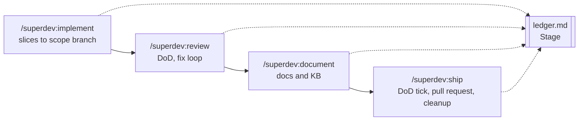

# 0013: The implement tail is a command chain, not one invocation

**Status:** Accepted

**Context.** `/superdev:implement` welds five steps behind the last slice merge: the whole-scope review,
the fix loop, the documentation pass, the Definition of Done tick, and the pull request. The maintainer
cannot inspect the merged scope branch before the documentation lands and the pull request opens. Every
run pays for an opus review and two documentation agents, whether or not the maintainer wants them at
that moment. The flow also contradicts the rest of the plugin, where `/superdev:brainstorm` suggests
`/superdev:plan` and `/superdev:plan` suggests `/superdev:implement`.

**Decision.** The tail becomes a chain of four commands, each of which prints the next one with its range
resolved. `/superdev:implement` stops once every slice sits on the scope branch. `/superdev:review`
reviews a scope range against `<run-root>/dod.md` and asks once before it fixes anything.
`/superdev:document` commits in the scope's checkout. A new command, `/superdev:ship`, ticks the
Definition of Done, closes the scope anchor, opens the pull request, and removes the run's worktrees and
lock. The ledger carries a `Stage` line that records the last completed stage: `implementing`, `merged`,
`reviewed`, `documented` (or `documented-unreviewed`, when `/superdev:document` ran before
`/superdev:review` did), or `shipped`. `/superdev:status` reports it.

**Why.** One command does one job, which is the shape every other superdev command already has. Stopping
between stages is what returns both control and cost to the maintainer, because a command that does not
run costs nothing. The chain needs somewhere to keep its position, and the ledger is the per-scope
recovery map that already survives compaction, so the stage lives there rather than in a second state
file.

`/superdev:ship` exists because the tail's remaining work has no other home. `/superdev:review` is
read-only for every ad-hoc range, and `/superdev:document` runs on branches that carry no pull request at
all.

**Considered options.**

- *Confirmation prompts inside `/superdev:implement`*. Rejected: a prompt keeps the whole chain in one
  invocation and one context, so it answers the control complaint but not the cost one.
- *A re-entrant `/superdev:implement` that performs the tail on a second invocation*. Rejected: it
  avoids a new command, but it needs a resume branch anyway, and "run implement again" reads as a repeat
  rather than as a next step.
- *`/superdev:document` opens the pull request*. Rejected: it puts code-host work in the documentation
  command, which also runs on a base branch where no pull request applies.
- *`/superdev:review` stays read-only in every case*. Rejected: the fix-until-clean loop then disappears
  from the flow with nothing to replace it.
- *A hard gate that blocks `/superdev:ship` until a clean review exists*. Rejected: it restores the
  entanglement the chain removes. `/superdev:ship` warns instead.
- *The stage inferred from artifacts rather than recorded*. Rejected: inference from a git log and a
  report file breaks quietly when a person commits documentation by hand.

**Consequences.** `/superdev:review` writes when it reviews a live scope, and stays read-only everywhere
else. The one-time question marks that boundary for the reader. The lite tier's scope worktree must
survive until `/superdev:ship`, because a lite run's documentation commit and any fix commit land there,
so worktree cleanup moves out of both execution playbooks. Each chained command finds its checkout from
disk: a scope worktree means a lite run, and no worktree means a full run whose scope branch sits in the
invoking checkout. The run lock spans four invocations only on the `lite` tier, because only the `lite`
tier's worktree-add needs the `run-lock` hook's guard. A `full` run never creates the lock. Each chained
command refreshes the lock's mtime when the file already exists, and never creates it, so a `full` run
never gains a lock that would guard nothing. The `run-lock` hook treats a lock older than one hour as
dead, which is why the refresh matters on a human-paced `lite` chain. A scope can reach a pull request
with no review and no documentation pass, which `/superdev:ship` names and asks about once. The stage is
one scalar naming the last completed step, so it records that a step happened but not the order steps ran
in. Where that matters, the chain resolves it toward re-running work rather than skipping it:
`/superdev:review` writes `reviewed` over `documented-unreviewed` when its fix loop landed commits, because
those commits made the earlier doc pass stale.
