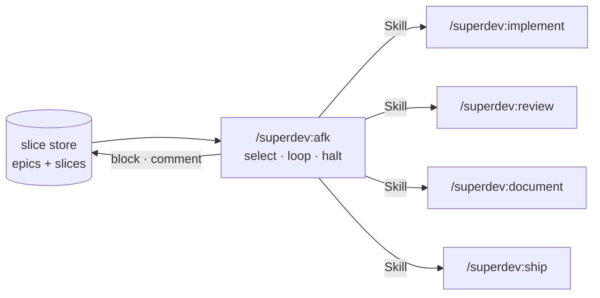

# 0015: `/superdev:afk` drives the chain through the Skill tool

**Status:** Superseded

**Superseded by:** [ADR 0108](0108-afk-is-removed.md), which removes `/superdev:afk`.

**Context.** The four-command chain is human-paste-driven (ADR 0013): each command prints the next one
and stops, and no superdev command reads or invokes another. `/superdev:afk` sweeps eligible epics with
nobody watching, so something has to take the maintainer's place at each handoff.

**Decision.** afk invokes each command with the Skill tool, the same mechanism a typed
`/superdev:implement` uses. It reads no command file and duplicates no procedure.

Verified 2026-08-20, on Claude Code 2.1.237: every superdev command is offered to the model as a
Skill-tool entry (`superdev:implement`, `superdev:review`, `superdev:document`, `superdev:ship` among
them), and the harness routes a typed `/<skill-name>` through that same tool. The equivalence this
decision rests on is the platform's own, not a superdev convention.

**Why.** A slash command is a prompt expansion, so an invocation and a paste deliver the same text to the
same agent. The chain keeps exactly one copy of its procedure, and a command afk drives behaves the way it
behaves when a maintainer types it.

**Considered options.**

- *afk carries its own copy of the four-step procedure*. Rejected: two copies of the chain drift apart,
  and catching that drift needs a new assertion in `drift-check.js` to guard a duplication that has no
  reason to exist.
- *One subagent owns each scope's chain, to bound context*. Rejected: `merge-guard` blocks a subagent's
  `git merge` and `git push`, so the `full` tier cannot integrate inside one.
- *`context: fork` on the afk skill, for the same context reason*. Rejected: it runs the skill in a
  subagent context, so `merge-guard` blocks the merge identically.

**Consequences.** The four chained commands stay model-invocable. `disable-model-invocation: true` on any
of them disables afk, so that flag is a breaking change to this command rather than a local safety tweak.
`/superdev:afk` itself carries the flag, because an unattended backlog sweep that opens pull requests is
the one invocation nobody wants Claude to choose on its own. afk runs the whole sweep in a single context
and compacts on a long night, which costs nothing: afk keeps no queue and re-derives its position from the
tracker's labels every iteration.
