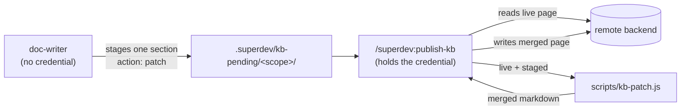

# 0027: An aggregate knowledge-base page is patched, not replaced

**Status:** Accepted

## Context

ADR 0023 gave `agents/doc-writer.md` a write path to a remote knowledge base, staging a page under
`.superdev/kb-pending/<scope>/` and letting `/superdev:publish-kb` send it, and took its backend access
away in exchange. It has no read path.

That holds for a page one scope owns end to end. It fails on a page that aggregates contributions from
many scopes. A staged page's `upsert` replaces the page wholesale, so a writer that cannot see the live
page can only overwrite every section already on it or decline. This repository's wiki shows both
outcomes: its `ADR summaries` page stopped at ADR 0022 while four more decisions landed, and ADR 0023
reached the wiki as a rival standalone page instead.

## Decision

A staged page carries a third `action`, **`patch`**, whose body is **one section**. `/superdev:publish-kb`
applies it by reading the live page and replacing that section where its heading already appears, or
appending it where the heading is absent. The merge itself runs in `scripts/kb-patch.js`, a deterministic
CLI, rather than in the command's prose.

Which pages take a `patch` is **knowledge-base configuration**: the outline in
`docs/agents/knowledge-base.md` marks the entries that aggregate across scopes, and `/superdev:setup` asks.
The writer reads that marker rather than judging page by page.

**Amended: the read is a requirement, not an assumption.** "Reading the live page" above named no call, and
no configuration document defined one that returns a page **body**. A find call that lists titles is not a
read. A backend may therefore mark a page `(aggregate)` and enable an action its own configuration cannot
perform. So: a configuration document that marks any outline entry `(aggregate)` **must** document a call
returning the page body, and how to get from a staged page's `title` to whatever identifier that call
takes. `/superdev:setup` captures that read alongside publish, find, update and remove, and will not leave
an entry marked without one.

The failure this closes is not the missing call but its fallback. `/superdev:publish-kb` treated "no live
page under this title" as the reason it held no body, and created the page from the single staged section,
so a page it merely failed to *read* was replaced by one scope's contribution, which is the loss this ADR
exists to prevent, reached through the documented procedure. **Only positive evidence of absence may create a page:
the find call does not list the title.** A `404` from the read call is not that evidence:
the read's identifier comes from the find call's own matching entry, so a `404` says the identifier is
wrong or the page was renamed between the two calls, never that the page does not exist. It joins the
read failures. Every other outcome leaves the file staged and is reported.

## Considered options

- **Give the writer a read-only backend call.** Smallest behavioural change, largest in principle: ADR
  0023's point is that the writer holds no credential, and a read still needs one.
- **Have the controller read the page and hand the content to the writer.** Costs a fetch on every doc
  pass, whether or not an aggregate page is involved.
- **Split every aggregate page into one page per item.** No new machinery, because today's `upsert` already does
  it. Rejected because it does not generalise: `Concepts` is nine sections that only mean something
  together, and an index page cannot be split at all.
- **Declare aggregate pages hand-maintained.** Honest about today and cheapest, but it writes off a page
  class every remote knowledge base grows.
- **Merge with an `append` action rather than a section-anchored one.** Rejected as not idempotent: a
  staged page survives a failed call and is retried, so an append would duplicate its section on the retry.

## Consequences

The credential stays in one command. The merge is deterministic and carries a `--selftest`, so a
reader-facing page is not edited by a model reading 25 KB of prose. A `patch` is idempotent by
construction, which is what makes it safe under `/superdev:publish-kb`'s retry.

Removing a single section is **not** covered: `patch` replaces or appends, and `delete` still removes a
whole page. A retired section is a hand edit until something needs otherwise.
