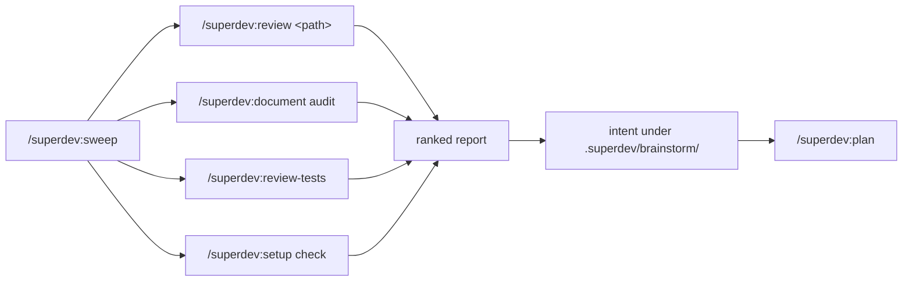

# 0068: A repository sweep chains the read-only surfaces

**Status:** Accepted

**Amends:** [ADR 0066](0066-a-measured-test-audit-is-its-own-surface.md), whose decision stands.
`/superdev:review-tests` remains a surface of its own, and gains a chained posture.

**Context.** A maintainer sweeps a repository periodically for drift, redundancy, and staleness. superdev
holds most of that capability already and it does not compose.

`/superdev:review <path>` resolves a clean path to standing code and reviews the files at `HEAD`.
`/superdev:document audit` reads the doc tree cold and grounds every claim. `/superdev:review-tests` sweeps
the test tree with measured durations. Each reports on its own, in its own shape, and nothing joins them.
Configuration drift has no surface at all: nothing reads `docs/agents/*.md` against the repository it
configures, so a test command that no longer resolves stays silent until a run fails on it.

Two of the three also act. The doc audit runs a `doc-writer` fix round that commits to the current branch,
and `/superdev:review-tests` puts its judgments to the operator and writes its own intent. Run back to back
by hand, a sweep on `main` commits to `main` partway through and produces two intents and two reports.

**Decision.** `/superdev:sweep [path]` is a chain-runner, read-only end to end, outside the implement chain
and outside `/superdev:afk` — the standing shape `/superdev:prose-check`, `/superdev:backlog`,
`/superdev:publish-kb`, and `/superdev:review-tests` already hold. It invokes four legs, states the swept
set, applies `/superdev:review`'s qualitative size caution to the tree, merges and ranks the findings, puts
them to the operator in one agreement round, and writes one intent under `.superdev/brainstorm/`.

Every leg runs in a **chained posture**: it returns findings and writes nothing. The code leg runs as
`/superdev:review <path> --chained`, which stages no untracked file into the index (no `git add -N :/`) and
never enters scope mode, whatever the invoking checkout's `HEAD` is — the write paths scope mode opens are
foreclosed by construction, not by a guard the sweep checks first. The doc leg dispatches no `doc-writer`
and commits nothing. The test leg runs no agreement round and writes no intent. The intent the sweep writes
is the run's only write, which is `/superdev:review-tests`'s own rule applied to the chain.

**`/superdev:setup check`** is the fourth leg and a new read-only mode on `/superdev:setup`, named by a
literal word the way `/superdev:document audit` is. The operator names the mode; the command sniffs nothing,
which is what ADR 0066 rejected when it refused a `--audit` flag on `/superdev:review`.

The per-context ceiling is unchanged. It lives inside the legs, and the sweep answers it the way ADR 0066
does: an optional path argument reaching the code and test legs, and a stated swept set.

**Why.** Every leg already exists or is one mode away, so the sweep buys composition rather than capability.
The chained posture is what makes composition honest: a merged report whose value is a triaged intent for
`/superdev:plan` is worth less if one leg rewrote tracked files before the operator saw a finding.

**Considered options.**
- *Nothing new — run `/superdev:review .` and `/superdev:document audit` back to back.* Rejected: it is what
  the maintainer does today, and it leaves two unmerged reports, a doc leg that commits mid-sweep, and
  configuration drift uncovered.
- *A sweep surface with its own whole-repository subagent.* Rejected: `/superdev:review-tests` already ships
  a whole-tree sweeper, so a merge command needs no new agent. A subagent's description is permanent context
  in every session, and this one would buy nothing the legs do not already hold.
- *A sweep that subsumes `/superdev:review-tests`, making tests one lens among code, docs, and config.*
  Rejected: it reverses a decision whose implementation is already built, and rehomes the timing-command
  configuration for no gain the chained posture does not deliver.
- *A thin next-command print, with `/superdev:review` naming `/superdev:document audit` as its successor.*
  Rejected: it merges nothing, which is the gap.
- *Letting the doc leg repair, so code and tests are read-only and docs are fixed in place.* Rejected: one
  surface with two postures, and a sweep run on `main` commits to `main`.
- *Reporting first, then asking whether to run the doc fix round.* Rejected: a second question competing
  with the agreement round ADR 0066 already defines, in the middle of a sweep.
- *Legs keeping their own behaviour, with the sweep folding `/superdev:review-tests`'s intent into a merged
  one.* Rejected: two agreement rounds in one sweep, and a command deleting another surface's output.
- *Fanning the code leg out by subtree so the whole tree is read.* Rejected: redundancy is a property of a
  pair, and a pair spanning two subtrees is invisible to both halves of a split. It gives up what the sweep
  is for.
- *Configuration drift as an inline leg the sweep performs itself, or as a deterministic
  `plugin/scripts/config-check.js`.* Rejected: an inline leg is unusable without the full three-sweep run,
  which is expensive; a script proves the file-level facts and leaves the store and host claims to the
  model, which is two mechanisms for one verdict.
- *A `## Standing code` section in `review-checklist.md` stating how every lens reads on a file set.*
  Rejected: `final-reviewer` already carries a blanket re-aim for standing code, so only the lens sentences
  scoped to *slices* rather than to change-versus-code actually break. Two sentences need fixing, not a new
  section with a routing row to pin it.
- *Naming the command `/superdev:audit`.* Rejected: `CONTEXT.md` defines **Audit** as the reader-first mode
  of `/superdev:document`, with an `_Avoid:_` line guarding it. ADR 0066 already calls this shape a sweep.

**Consequences.** `/superdev:sweep`'s own description loads in every session, whether or not a sweep ever
runs. No new subagent does.

`/superdev:document` and `/superdev:review-tests` each carry a second posture, so a change to either must
keep both readings correct. The unchained behaviour of both is unchanged.

A repository too large for one context gets a partial sweep and is told so. The operator narrows with the
path argument, exactly as ADR 0066 states for the test tree.

`final-reviewer`'s **Brevity (whole-scope)** axis and `review-checklist.md`'s *cross-slice divergence*
bullet restrict themselves to what spans slices. On standing code there are no slices, and
`simplicity-reviewer` is skipped on that target, so redundancy had no lens reaching it. Both sentences
state their standing-code reading.
