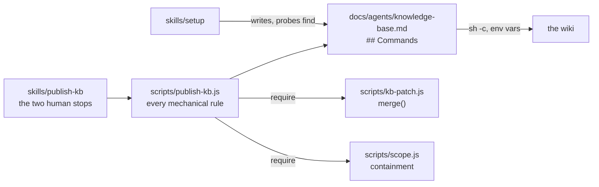

# 0069: The knowledge-base backend is five command templates, not prose and not generated code

**Status:** Accepted

**Amended by:** [ADR 0150](0150-shipped-code-starts-a-shell-only-for-an-operator-command.md), which runs the templates under `sh` from PATH, and [ADR 0168](0168-a-flat-wikis-hierarchy-is-its-parents-links-edited-live-by-publish-kb.md), which names `sub_url` as an optional `find` key, and [ADR 0207](0207-superdev-defines-no-environment-variable.md), which passes the placeholders as one JSON file named by `$1` instead of environment variables.

**Context.** `/superdev:publish-kb` moved bytes by reading prose. Its skill body carried the whole
mechanism: which staged files collide on a title, what separates a page that is absent from a read that
failed, when a staged file may be deleted, and how to reach the backend at all. Three costs followed. The
same staging directory could be handled two ways on two runs, because a model interpreted the rules each
time. Publishing paid a thinking task's context bill to perform no thinking. And the rules had accreted
across ADR 0023 and ADR 0027 until a single edit could break an invariant, guarded only by regexes in
`scripts/drift/contracts.js` that assert a sentence survived rather than that the behaviour holds.

Only one part of the command is per-repository: the call that reaches the backend. Everything else is the
same in every repository that publishes at all.

**Decision.** `plugin/scripts/publish-kb.js` owns every backend-independent rule. The backend is declared
as **five shell command templates** — `find`, `read`, `create`, `update`, `delete` — under a `## Commands`
section of `docs/agents/knowledge-base.md`, one `### <verb>` subsection each holding one fenced `sh`
block. `/superdev:setup` writes them. The script reads them **by heading name**, runs each under
`/bin/sh -c`, and passes every placeholder as an **environment variable** rather than interpolating it
into the command string.

`find` carries the contract the other four rest on:

| `find` exit | Meaning |
|---|---|
| `0`, JSON object on stdout | The page exists. Each key becomes `SUPERDEV_KB_<KEY>` for the later verbs. |
| `3` | The page is genuinely absent. |
| anything else | The backend could not answer. Leave the page staged. |

One key of the JSON object is named (ADR 0168): a `find` template may emit `sub_url`, the page's address,
and `publish-kb.js` fills a `{sub_url}` placeholder in a `parent-link` target from it. The key is
optional. A backend whose `find` emits none gets the not-linked refusal for a `parent-link` that carries
the placeholder.

A second key is named: `type`. A `find` result whose `type` is `folder` marks a container, and
`publish-kb.js` refuses an upsert or delete for it, naming the folder. The key is optional.

**Considered options.**

- **`/superdev:setup` generates the whole script per repository.** The opening proposal. Rejected: a model
  writing the script does not remove the nondeterminism, it moves it to generation time and freezes one
  arbitrary reading of the rules per repository — untested, and unreachable by a plugin upgrade that fixes
  one. That is worse than prose, which at least reads the same everywhere.
- **The backend as declarative REST data** — URL templates, auth variable names, JSON paths for the
  identifier and the version. Rejected: covering both Confluence v2 and an unnamed internal wiki means
  inventing a REST-client schema with identifier extraction, version increment, body encoding, and
  pagination. It also fails the open-ended backend outright.
- **The script does the mechanics and the skill keeps the backend calls.** The smallest change, and it
  invents no contract. Rejected: a model stays in the loop for every page, so the context cost drops
  without going away and the backend call stays nondeterministic. It loses on two of the three costs.
- **Positive absence as exit 0 with empty stdout.** One less concept, and no explicit exit in the
  template. Rejected: every accidental empty result — `curl` without `-f` returning a 404 body, a filter
  that matches nothing on an authorization error — then reads as absence, which creates a duplicate page
  or overwrites an aggregate page. A distinct exit code makes the destructive verdict deliberate, and
  every accidental path falls through to "could not answer".
- **Fenced blocks read by index**, the shape `docs/agents/verification.md` uses. Rejected: a block
  inserted or removed shifts every verb after it. `hooks/green-gate.js` already carries that hazard, which
  is why a timing command is a backtick span rather than a third block.
- **A runtime prose fallback for a repository configured before `## Commands` existed.** Rejected: it
  ships both implementations, so the dense prose and its drift rows stay and the maintainability cost
  returns. The script refuses and names `/superdev:setup` instead.

**Consequences.** ADR 0027's precondition becomes structural: a backend declaring no `read` block cannot
mark any outline entry `(aggregate)`, because the script has no way to fetch a live body. The read-failure
rule that `docs/agents/knowledge-base.md` spends five sentences on — a 404 from `read` for a title `find`
listed is not absence — falls out of the exit codes without prose. Every rule that was a drift-row regex
becomes an assertion in `tests/publish-kb.test.js`, which tests behaviour rather than the survival of a
sentence.

A repository configured before this section existed publishes nothing until `/superdev:setup` runs again,
and the script says so. The template author owns a convention that can destroy a page when written wrong,
so `/superdev:setup` probes `find` once against a title that cannot exist and requires exit 3 before it
writes the section.

`hooks/scope-prune.js` keeps its own containment test, which omits the refetch by design (ADR 0065). The
shipped tree therefore carries two, as it already did.
