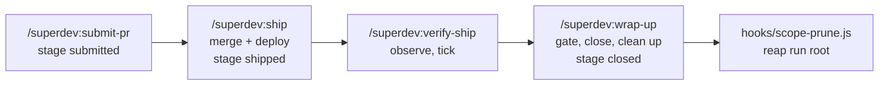

# 0106: Verifying and closing a shipped scope are separate human-only commands

**Status:** Accepted

**Amended by:** [ADR 0110](0110-the-local-file-slice-store-is-removed.md), which removes the local
plan-file store, so point 7 below describes a store superdev no longer ships.
**Amended by:** [ADR 0116](0116-ship-names-wrap-up-when-nothing-is-left-to-verify.md), which qualifies
point 1 below: ship prints `/superdev:wrap-up <scope>` instead when nothing is left to verify.
**Amended by:** [ADR 0124](0124-a-failed-verification-is-repaired-by-its-own-fix-feature.md), which routes a
`shipped` run holding a `not met:` line to `/superdev:plan`'s repair choice.
**Amended by:** [ADR 0132](0132-ship-is-the-only-human-only-skill-and-offers-the-rest.md), which lifts the
human-only flag from verify-ship and wrap-up in point 4: only ship keeps it.

**Amends:** [ADR 0040](0040-the-sweep-defers-an-anchor-whose-blocker-has-not-shipped.md),
[ADR 0096](0096-opening-the-pull-request-and-merging-it-are-separate-commands.md) point 5, and
[ADR 0101](0101-ship-applies-the-deploy-posture-after-the-merge.md) point 3.

**Context.** `/superdev:ship` merges the pull request and applies the deploy posture (ADR 0096, ADR 0101).
It then closes the scope anchor and removes the run's scaffolding. A criterion that only a deployed system
can show carries a `ceiling:` note, and nothing in superdev ever verifies it. Anchors therefore closed
with such criteria unticked. In one repository, two anchors closed with 7 of them never verified, and a
third moved its post-merge checks out of the Definition of Done into prose. A dependency counted as
satisfied at the stage `shipped`, so a dependent feature could start against a blocker whose live
verification had not run.

**Decision.**

1. **`/superdev:ship` stops after the deploy.** It sets the stage `shipped`, applies the posture, and
   prints `/superdev:verify-ship <scope>`. It closes no anchor and removes nothing.
2. **`/superdev:verify-ship` observes.** It reads every Definition-of-Done line that is neither ticked
   nor `accepted:`. It observes each line read-only, and it runs no deploy target's command. An observed
   line ticks with its evidence. A line observed false stays unticked with a `not met:` note that names
   the observation. For a line it cannot observe, it asks the operator: verified, false, accepted as
   unverifiable, or later. Before it observes, it checks the deploy record. A target under `auto` that is
   not `deployed` refuses, and the remedy is `/superdev:ship`. A target that reads `pending`, or has no record, under
   `manual` asks the operator once whether it deployed. A yes records `deployed`, and a no refuses.
   Running it again is safe, and it never moves the stage.
3. **`/superdev:wrap-up` gates, closes, and cleans up.** It refuses, naming every reason, while any of
   these holds: the pull request is not merged, a line is neither ticked nor `accepted:`, or a listed
   target is not recorded `deployed`, a target with no deploy record included. It judges the criteria
   from `dod.md`, which stays authoritative over a best-effort anchor tick. A remote anchor that disagrees
   with it refuses, naming `/superdev:verify-ship` as the reconciler. For each standing `**Unresolved:**` entry it asks once whether to
   close with the entry standing. Then it closes the anchor and every open slice record. A failed close
   stops the command with the stage and the scaffolding unchanged. Slice records closed before the
   failure stay closed, so a rerun converges. After a successful close it removes the
   scopetree, the slicetrees, the run lock, and the slice branches, and sets the new terminal stage
   `closed`. The scope branch stays for `hooks/scope-prune.js`.
4. **Both commands are human-only.** Each carries `disable-model-invocation: true` and has no unattended
   mode. Every unattended run still ends at `/superdev:submit-pr`.
5. **An anchor dependency is satisfied only by the blocker's closed anchor, or by no such anchor
   existing.** The ledger stage no longer counts. This amends ADR 0040's rule.
6. **`hooks/scope-prune.js` reaps a run root only at `closed`.** A run root an older version left at
   `shipped` stays until an operator runs `/superdev:wrap-up` on it, which applies the same gate.
   Re-initialising a `shipped` run is refused until wrap-up closes it.
7. **The local plan-file store: wrap-up writes nothing to it, and verify-ship refuses.** Its anchor is a
   tracked file on base, and a post-merge write to base needs its own branch and pull request.
   `/superdev:submit-pr` keeps committing the close on the scope branch, so it rides the pull request.
   `/superdev:wrap-up` therefore writes nothing to the store. It still gates on the merged pull request
   and the deploy record, asks about standing `**Unresolved:**` entries, cleans up, and sets `closed`. It
   judges the criteria from `dod.md`, since the anchor on base is frozen at the merge.
   `/superdev:verify-ship` has no post-merge write and refuses there, pointing at `/superdev:wrap-up`.
   `/superdev:ship` prints `/superdev:wrap-up` as its next command on that store.
   Because that store has no verify-ship, wrap-up carries two exceptions there, both attended and both run
   once no reason other than the local-store asks holds; answers the operator already gave stand across a
   later refusal, and the gate changes nothing while any reason that is not an ask holds. It offers to accept an unsettled `ceiling:` line as unverifiable,
   writing `accepted:` into `dod.md`; a `not met:` line gets no offer. It asks the manual-deploy question
   itself, once per listed `manual` target not recorded `deployed`; a yes records `deployed`, and a no
   leaves the target a reason that names no command.

**Why.** Each command does one job whatever state it finds, or it refuses and names why. A command whose
behaviour follows from its name is predictable to run again. Verification and close are separate because
verification can take several passes, for example after a manual deploy or a fix, and the close is
permanent. A strict close means a `closed` ledger always sits over a closed anchor. The anchor alone is
therefore enough for the dependency rule, and an anchor a human reopens makes its dependents wait again.
Reaping only at `closed` means no run root disappears before `/superdev:wrap-up` has checked it.

**Considered options.**

- *One `ship` whose behaviour depends on the state it finds* (run once to merge, again to verify). The
  operator rejected it: what a command does should follow from its name.
- *One `ship` running merge, deploy, verify, and close in one go.* Deploys and reviews vary per
  repository, so the operator needs a stop between each step.
- *`/superdev:wrap-up` verifying ceiling criteria itself.* Wrap-up is a gate plus cleanup. Verification
  is a separate job, and it may need several passes. The local plan-file store is a deliberate exception: it has
  no verify-ship, so wrap-up alone accepts a `ceiling:` line as unverifiable there, and asks the
  manual-deploy question.
- *No superdev home for post-deploy verification; the operator ticks by hand.* A tick would carry no
  evidence.
- *`verify` or `review-ship` as the command name.* `verify` alone is ambiguous in autocomplete, and
  `review-ship` collides with `/superdev:review`.
- *A best-effort close, as `/superdev:ship` had.* It saves a rerun when the store is unreachable. It
  leaves an open anchor over a `closed` ledger, and after the reap an operator must close it by hand.
- *Satisfy a dependency by the blocker's `closed` ledger as well as its closed anchor.* A strict close
  makes the ledger redundant. It would also count as satisfied a blocker whose anchor a human reopened.
- *Keep reaping a `shipped` run root whose scopetree is gone.* Legacy run roots would clean up
  themselves. A run whose scopetree an operator removed by hand would be reaped before wrap-up checked it.
- *`/superdev:ship` keeps its old cleanup on the local store.* Rejected: ship would do two jobs on one
  store, stopping after the deploy on remote stores and cleaning up on the local one.
- *Refuse on a standing `**Unresolved:**` entry.* It is strict, but the operator already acknowledged
  the entry at `/superdev:submit-pr`, and nothing in superdev can repair it yet.
