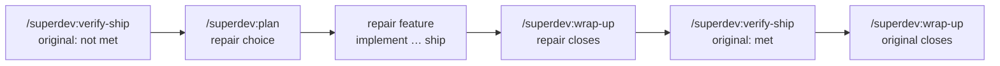

# 0124: A failed verification is repaired by its own fix feature

**Status:** Accepted

**Amends:** [ADR 0083](0083-a-shipped-scope-takes-no-append.md), whose remedy for follow-up work on a
shipped feature deadlocks when that feature holds a criterion observed false, and whose two shipped
signals miss a feature shipped on another machine, and
[ADR 0106](0106-verifying-and-closing-a-shipped-scope-are-separate-human-only-commands.md), whose routing of a
`shipped` run has no outcome for such a criterion, and
[ADR 0042](0042-run-state-is-mirrored-to-the-scope-anchor.md), whose `scope.js adopt` refuses every
`shipped` snapshot.

## Context

`/superdev:verify-ship` writes `not met: <observation>` on a Definition-of-Done line it observes false. The
line holds the original scope's `/superdev:wrap-up` refusal, and nothing in superdev plans the fix. The
remedy ADR 0083 names for work on a shipped feature, a new feature carrying `**Blocked by feature:**
#<anchor>`, deadlocks here: ADR 0106 point 5 satisfies that dependency only once the named anchor is
closed, and the anchor cannot close while the line reads `not met:`.

The brainstorm intent for this work asked for the repair to run under the original's own anchor. Four
contracts on `main` assume one run per anchor:

- An anchor carries exactly one machine-owned `## Run state` section, replaced wholesale on every publish,
  and `scope.js adopt` refuses a body with two markers.
- A store finds the anchor through the feature label. An epic carrying two feature labels has no rule.
- Run init stops when the anchor's snapshot reads `shipped`.
- Definition-of-Done ticks pair with anchor lines by criterion text, so two run roots would write the
  same lines, and wrap-up refuses an anchor that disagrees with its own `dod.md`.

## Decision

1. **A repair is its own `fix` feature.** It has its own scope anchor, feature label, scope branch, and
   run root, and the chain from `/superdev:implement` to `/superdev:ship` runs it unchanged. Its label
   defaults to `fix/<scope>-repair`, with a numeric suffix when that label exists as a store label, a
   branch, or a run root.
2. **`/superdev:plan` enters it as a third choice beside new and extend.** The candidates are the run
   roots at `shipped` whose `dod.md` holds a `not met:` note `/superdev:verify-ship` observed, one that
   carries the repair citation (point 6), and the scope anchors with no local run root whose `## Run state`
   snapshot reads `shipped` and whose Definition of Done holds such a note (point 8). A run whose
   `not met:` notes all carry no citation is no candidate. Plan names `/superdev:verify-ship` as its next
   step.
3. **The repair's Definition of Done is its own.** It starts from a reproduction and carries none of the
   original's criteria. The original's failed lines seed the interview. A `not met:` line the original
   holds with no repair citation is shown beside them as context, not as seed.
4. **The repair anchor carries `**Repairs:** #<original anchor>`.** Nothing is written to the original
   anchor, its `dod.md`, or its ledger.
5. **Only the original's `/superdev:verify-ship` settles the original's line.** The original's
   `/superdev:wrap-up` gate is unchanged: the standing `not met:` line already refuses the close, and an
   open repair adds no reason of its own.
6. **A `shipped` run holding an observed `not met:` note routes to `/superdev:plan`'s repair choice, or
   to `/superdev:verify-ship` again.** The second covers an observation that was transient.
   `/superdev:verify-ship` ends every `not met:` note it writes with a repair citation, ` (observed)` or
   ` (observed; after <key>, <key>)`, naming every closed anchor whose `**Repairs:**` line names the run
   at that moment. Only a note carrying the citation routes a run to repair. A `not met:` note written
   before merge, by a controller's tick or by `/superdev:submit-pr`'s standing-entry ask, carries none:
   nothing has observed the deployed system for it yet, so a run whose `not met:` notes all carry none
   routes to `/superdev:verify-ship` first. Once a closed anchor's `**Repairs:**` line names the run, an observed `not met:` note does not cite
   that anchor, and no open anchor's line names the run, a repair has closed since the line was last observed
   and none is under way. The run then routes to `/superdev:verify-ship` first, with the repair choice as
   the alternative. A run whose observed notes cite every closed repair failed again after those repairs, and
   routes to repair. `/superdev:verify-ship`'s own end applies the same rule and prints its outcome as
   every other caller does. A line written before merge that the operator deferred keeps its uncited
   note, so a run whose `not met:` notes were all written before merge ends on `/superdev:verify-ship`
   again. While a line holds an observed `not met:` note and an open anchor's `**Repairs:**` line names
   the run, the run routes to repair, whatever closed repair names it too. The route still names
   `/superdev:plan` then, and adds one line per open repair, `repair <key> is open; finish its chain
   first`. For a run holding an observed `not met:` note, `/superdev:backlog` shows the run as awaiting
   repair while an open anchor's `**Repairs:**` line names it, as awaiting verification while a closed
   repair is not yet cited, and as needing a repair otherwise. A run holding a `not met:` line that it shows in any
   other bucket under an open anchor still names each open repair of that run. The citation needs no
   date and no new store field: the note is free text, and the set of closed repairs only grows.
7. **ADR 0083's remedy splits.** A shipped feature holding a `not met:` line is refused an append and
   pointed at the repair choice. While none of its `not met:` notes carries the repair citation, the
   refusal names `/superdev:verify-ship` first. Every other shipped or closed feature keeps the `**Blocked by feature:**`
   remedy.
8. **A shipped original with no local run root is adopted from its anchor.** A run done on another
   machine, or a run root already reaped, survives only as the anchor's `## Run state` snapshot.
   `/superdev:plan`'s repair choice, `/superdev:verify-ship <scope>`, and `/superdev:wrap-up`'s hand-off
   from a closed repair recreate the run root from that snapshot, by one rule in
   `references/scope-mode.md`: the ledger through `scope.js adopt --shipped`, which adopts the stage
   `shipped` and refuses every other one, and `dod.md` from the anchor's checklist. Plain `adopt` and run
   init keep refusing a `shipped` snapshot, so `/superdev:implement` never resumes a shipped run.
   `/superdev:backlog` adopts nothing: it routes such an anchor from the anchor alone, and with no deploy
   record to read it names `/superdev:verify-ship` ahead of `/superdev:wrap-up` (INV-0132).
   `/superdev:plan`'s extend refusal reads the same snapshot as a third shipped signal beside ADR 0083's
   two. Such a feature has no local run root and an anchor still open, so neither of those fires. A
   snapshot stage of `shipped` or `closed` refuses as the ledger stage does, and the refusal splits by
   point 7, reading the `not met:` lines off the anchor's checklist. The snapshot is read off the anchor
   body the extend path already loads. A failed read of that body refuses, because the gate fails closed
   on a state it cannot read. A snapshot-less store, or an anchor with no `## Run state` section, leaves
   ADR 0083's two signals to decide (INV-0004).

## Why

A separate feature runs every existing chain command and contract unchanged, and the original's records
stay readable against the change they were verified against (INV-0004). The `not met:` line is already
the gate that keeps the original open, so a link that only routes needs no reader on the original's side.

## Considered options

- *A second run under the original's anchor* (the intent's design). It keeps the whole story on one
  issue. Rejected: it breaks the four one-run-per-anchor contracts above.
- *Continue the original's run root under a rotated ledger.* Rejected: `scope.js init` refuses a
  `shipped` ledger, and the branch would carry the original's `feat` type for a fix (ADR 0021).
- *A follow-up feature carrying `**Blocked by feature:**`* (ADR 0083's remedy). Rejected: it deadlocks
  under ADR 0106 point 5.
- *Copy the failed criterion into the repair's Definition of Done.* The repair could not close while the
  live criterion is false. Rejected: two anchors would observe and tick one criterion.
- *A `**Repaired by:**` back-link on the original anchor.* Every store, Jira included, would show the
  repair from the original. Rejected: it writes to a shipped anchor, and no reader needs it once the
  original's wrap-up adds no gate.
- *The original's wrap-up refuses while a repair anchor is open.* It keeps the intent's commitment as
  written. Rejected: the `not met:` line already refuses, and the extra gate only delays dependents whose
  criteria the original already holds.
- *A `--repair <scope>` argument to `/superdev:plan`.* It gives verify-ship a command ready to paste.
  Rejected: plan already asks new or extend before its interview, and a third choice there needs no new
  argument parsing.

## Consequences

- A repair's history spans two issues, joined by the `**Repairs:**` line. On a store that renders no
  cross-reference, a reader on the original issue does not see the repair.
- An original can have several repairs at once. Each one is its own feature.
- A repair that itself ships with a criterion observed false is repaired the same way.
- A snapshot-less store, such as a default Jira instance, publishes no snapshot, so an original with no
  local run root cannot be repaired there.
