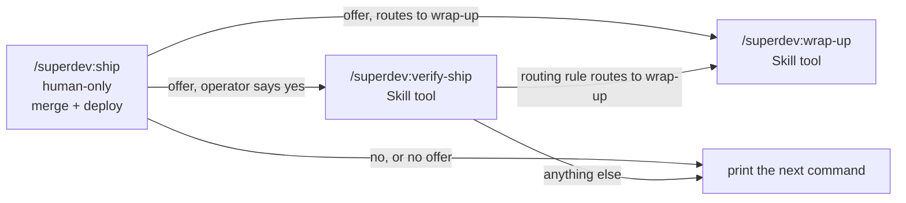

# 0132: Ship is the only human-only skill, and it offers the rest

**Status:** Accepted

**Amends:** [ADR 0106](0106-verifying-and-closing-a-shipped-scope-are-separate-human-only-commands.md)
point 4, and [ADR 0116](0116-ship-names-wrap-up-when-nothing-is-left-to-verify.md)'s final hand-off.

**Amended by:** [ADR 0157](0157-every-chain-command-offers-to-start-its-successor.md), which makes ship
model-invocable and offered by `/superdev:submit-pr` (point 1), replaces ship's one yes for verify-ship and
wrap-up with verify-ship's own offer (point 3), and has a typed verify-ship offer wrap-up (point 5).

**Amended by:** [ADR 0223](0223-a-skill-adds-no-offer-condition-of-its-own.md), which drops point 2's
conditions: ship offers the next command it prints at every exit, a refusal included, under
`references/response-shapes.md`'s `## The offer` alone.

## Context

ADR 0106 made `/superdev:ship`, `/superdev:verify-ship`, and `/superdev:wrap-up` human-only. Each
carries `disable-model-invocation: true`, so the Skill tool refuses it. After a clean ship, an agent in
a conversation must stop and tell the operator to type the next command, then the one after it. Both
later commands already refuse on every unsafe state and ask the operator about every judgment, so the
flag adds a block on the agent and no safety the commands lack.

## Decision

1. **Only `/superdev:ship` carries `disable-model-invocation: true`.** `/superdev:verify-ship` and
   `/superdev:wrap-up` are model-invocable. None of the three has an unattended mode, and every
   unattended run still ends at `/superdev:submit-pr` (INV-0093).
2. **Ship offers the next step.** At its final hand-off, ship asks the operator once whether to continue
   when all of these hold: the merge landed, no listed deploy target is pending, failed, or unrecorded, and
   the shipped-run routing rule routes the run to verify-ship or to wrap-up. A run that routes to repair or
   to re-verify, a run with an unpaired Definition-of-Done line waiting for a hand-sync, a refusal, and a
   failed or declined deploy get no offer. An answer that is not a clear yes counts as no, and ship prints
   the command as it does today. A yes starts the routed skill through the Skill tool. A refused or failed
   start prints the command and stops.
3. **One yes covers the rest.** After a started verify-ship returns, ship applies the routing rule again.
   When it routes to wrap-up with no hand-sync pending, ship starts wrap-up with no second ask. Any other
   outcome stops, prints the next command, and starts no wrap-up. Only the last message of the chain
   carries the Next block.
4. **wrap-up and verify-ship keep every gate and every ask.** A start from ship bypasses none of them, and
   each refusal or ask reaches the operator.
5. **A `/superdev:verify-ship` the operator types starts no wrap-up.** Verification can take several
   passes, and the close is permanent (ADR 0106).
6. **No model starts either skill unless the operator typed the command, asked for it, or agreed to
   ship's offer.** The two skills' descriptions state this, and their own gates back it. The platform
   enforces nothing here once the flag is gone, so the bound is prose and a drift pin on that prose.

## Considered options

- *`--unattended` for verify-ship and wrap-up, blocking on each ask.* Both need the stage `shipped`, which
  only the human-only ship sets, so an unattended chain never reaches them. It would also reverse
  INV-0093 and close anchors and delete worktrees unread.
- *Open only verify-ship and keep wrap-up human-only.* The operator wants ship as the only human-only
  skill, and the permanent close is the step the offer exists to carry.
- *Drop the flag and rely on the gates alone.* An agent could close a scope before the operator saw the
  verification.
- *Offer wrap-up at the end of a `/superdev:verify-ship` the operator typed.* A typed verify-ship can be one
  of several passes, and the close is permanent.
- *A hook that blocks the Skill tool outside ship's chain.* It restores the platform's block, at the price
  of a new hook, a suite, and a dependency on how Claude Code reports a skill start to a hook. The gates
  already refuse every unsafe close.

## Consequences

INV-0066 and INV-0093 state the new split. The `ship-human-only` drift check pins ship alone, and
`model-invocation-split` pins verify-ship and wrap-up as model-invocable. Two skill descriptions join the
permanent skill listing, so each states the start condition in its first words.
