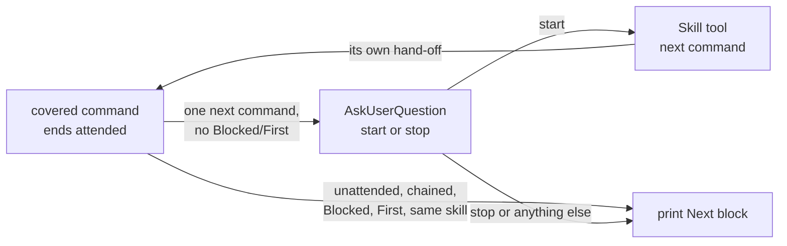

# 0157: Every chain command offers to start its successor

**Status:** Accepted

**Amends:** [ADR 0132](0132-ship-is-the-only-human-only-skill-and-offers-the-rest.md) points 1, 3, and 5,
[ADR 0013](0013-implement-tail-is-a-command-chain.md)'s rejection of confirmation prompts, and
[ADR 0113](0113-commands-end-on-a-shared-next-block.md)'s set of covered commands.

**Amended by:** [ADR 0224](0224-verify-ship-starts-wrap-up-when-every-line-settles.md), which has verify-ship
start wrap-up at its settled exit instead of offering it (decision 6).

**Amended by:** [ADR 0223](0223-a-skill-adds-no-offer-condition-of-its-own.md), which lets no skill add an
offer condition of its own.

**Amended by:** [ADR 0213](0213-a-stop-hook-holds-the-offer.md), which enforces the offer with a Stop hook.

**Amended by:** [ADR 0176](0176-the-offer-recommends-a-new-session.md), which makes the offer recommend a
new session where the desktop app's session tool is present, and Stop here where it is absent (point 2).

## Context

Every chain command except `/superdev:ship` ends by printing its next command in the Next block (ADR 0113).
The operator then types or pastes that command, with its resolved range, to continue. The answer is
almost always "continue". An operator who steps away comes back to a stalled chain, because nothing asks
for attention. In the desktop app's Code tab, a question with buttons takes one click, and a printed
command takes typing. Ship alone offers to start its successor (ADR 0132), so the hand-off is
inconsistent.

## Decision

1. **A covered command offers its successor.** An attended run of `/superdev:brainstorm`,
   `/superdev:plan`, `/superdev:implement`, `/superdev:review`, `/superdev:document`,
   `/superdev:submit-pr`, `/superdev:ship`, `/superdev:verify-ship`, `/superdev:wrap-up`,
   `/superdev:sweep`, or `/superdev:review-tests` that ends on a Next block naming exactly one next command,
   with no `Blocked:` or `First:` line, asks once through `AskUserQuestion` whether to start it. A refusal
   exit and an ad-hoc exit offer the same way. `Or:` alternatives are printed and never offered. A next
   command whose skill is the skill that is ending gets no offer.
2. **The offer has a start option and a stop option.** Start runs the command through the Skill tool with
   the arguments the Next block would print. Stop names "`/clear`, then type the command" as the cheaper
   path, because a started command inherits the conversation's context. Stop, any other answer, a question
   the platform cannot ask, and a start that fails each print the Next block and start nothing.
3. **A started command is the same command.** It keeps every gate and every ask it has when typed, and its
   own hand-off offers again. The offering command prints nothing after it returns. A command another
   command starts through its own step, such as implement starting plan, makes no offer.
4. **An unattended run makes no offer.** Neither does a command in the chained posture. Every unattended
   run still ends at `/superdev:submit-pr`.
5. **`/superdev:ship` is model-invocable.** `/superdev:submit-pr` offers it. The offer names the pull
   request, says nobody has reviewed it yet, and says a yes merges it now. The yes carries the weight that
   typing `/superdev:ship` carries. Host approvals and branch protection still apply. Ship, verify-ship,
   and wrap-up each state in their descriptions that they start only when the operator typed the command,
   asked for it, or agreed to an offer. Ship refuses an `--unattended` argument.
6. **verify-ship offers wrap-up** when every Definition-of-Done line is settled and no hand-sync is
   pending. Ship starts verify-ship exactly as the operator would type it, and starts no wrap-up after it
   returns. The `--from-ship` path is removed.
7. **The offer rule is written once**, in `references/response-shapes.md` beside the Next block. Each
   covered command refers to it. `/superdev:sweep` and `/superdev:review-tests` close with the Next block,
   like the other covered commands.

`/superdev:setup`, `/superdev:upgrade`, `/superdev:backlog`, and `/superdev:status` make no offer. Plan
and implement start setup inside their own runs. Upgrade's successor, `/reload-plugins`, is a built-in
command the Skill tool cannot start. Backlog and status name no single successor.

## Considered options

- *Offer only where the context is small or useful, and keep printing after `/superdev:implement`.* The
  hand-off stays uneven, which is one of the pains. The operator owns the context cost per run, and the
  stop option names the cheaper path.
- *Start the successor in a fresh session.* A skill in Claude Code cannot `/clear` or open a session, and
  Claude Code is superdev's only harness (ADR 0102).
- *Run the successor as a subagent.* Review and document dispatch their own subagents, and a subagent
  cannot dispatch one.
- *Keep `/superdev:ship` human-only.* The operator wants every edge offered. The yes to submit-pr's offer
  carries the same weight as typing the command.
- *Ask "Is the pull request reviewed?" before the ship offer.* One extra step that the yes already carries.
- *Keep ship's one yes for verify-ship and wrap-up (`--from-ship`).* Two paths for one rule. The permanent
  close gets its own yes.
- *Keep the plain-text question ship asked.* `AskUserQuestion` gives the desktop app its buttons and the
  CLI its selector.

## Consequences

INV-0066, INV-0093, and INV-0111 state the new split. The `past-pr-skills` drift check replaces
`ship-human-only`. Under ADR 0153 it checks facts and forbidden forms only: ship, verify-ship, wrap-up,
and publish-kb carry no `disable-model-invocation: true`, verify-ship and wrap-up name no `--unattended`,
and no `--from-ship` remains. No check pins the wording of the offer rule, its citations, or the start
conditions; `final-reviewer`'s invariant compliance judges them. A model that ignores a description can still start ship, and only
the description, the offer, and host branch protection bound that. An attended run is longer than before
when the operator starts each successor in place, because the conversation carries every earlier
command's context.
