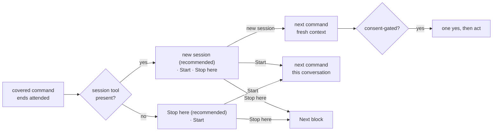

# 0176: The offer recommends a new session

**Status:** Accepted

**Amends:** [ADR 0157](0157-every-chain-command-offers-to-start-its-successor.md) point 2, and its
considered option *Start the successor in a fresh session*.

**Amended by:** [ADR 0183](0183-the-offer-proposes-the-new-session-as-a-card.md), under which the new-session
answer proposes the session as a New task card instead of starting it (point 1).
[ADR 0201](0201-the-offer-puts-up-the-card-first.md), under which the offer asks no question where the
session tool is present, and a brief-started consent-gated command asks first too (points 1 and 5).
[ADR 0214](0214-only-ship-asks-a-started-session-for-consent.md), under which only ship asks the one yes
(point 5).

## Context

A command started through the offer's Start option runs in the conversation that offered it, and every
call it makes re-reads that conversation. Transcripts of superdev runs in three repositories, measured on
2026-10-23, show 455 chain-command starts at a median context of 250k to 290k tokens. A new session starts
at a median of 36k. `/superdev:review` started at a median of 288k, and `/superdev:ship` at 314k.
Main-thread calls inside the chain commands after `/superdev:implement` carry about 15% of the
price-weighted tokens of all measured runs.

The run root holds the state each command reads, so the history adds no input. Since 2026-08-19, run
handoff, review, and document each say that "a `/clear` first costs nothing". The measurements show that
the sentence did not change what operators do. 13 of 15 recorded offer answers chose Start. The operator
named the cause: Start takes one click, and the fresh path takes a click, `/clear`, and a typed command.

ADR 0157 rejected a fresh-session start, because a skill in Claude Code cannot `/clear` or open a session.
In the Claude desktop app's Code tab, the session tool `mcp__ccd_session__start_session` starts a session
from a prompt with `context: "fresh"`.

## Decision

1. **Where the session tool is present, the offer has three options.** *Start in a new session* comes
   first and is marked recommended, then Start, then Stop here. The new session starts with a fresh
   context and shares this checkout (`use_worktree: false`). Its prompt is the command exactly as the Next
   block's fence prints it, plus a line saying that an offer started it.
2. **Where the tool is absent, Stop here comes first and is marked recommended.** Its description carries
   the `/clear`-then-type path. Start stays as the second option.
3. **The rule is uniform.** It holds on every offer of every covered command. Start stays on every edge,
   so an operator who wants the conversation carried keeps it at one click.
4. **The offering command still ends on its Next block.** After a new-session start, one line before the
   block links the started session. A refused or failed session start prints the Next block, as Stop here
   does.
5. **A consent-gated successor asks again in the new session.** `/superdev:ship`, `/superdev:verify-ship`,
   and `/superdev:wrap-up` start only when the operator typed the command, asked for it, or agreed to an
   offer (INV-0093). A new session's prompt is model-written, so each of the three, started from an offer's
   new-session prompt, asks the operator one yes before it acts.
6. **A chain command reads its state from its arguments and the run root** (INV-0172). That is what makes
   the three starts equivalent.

## Considered options

- *Rephrase the Stop here description only.* It already names the cost, and 13 of 15 answers still chose
  Start.
- *Add a `/clear` line to the Next block.* The same sentence has stood before the block in three skills
  since 2026-08-19, and review still starts at a median of 288k.
- *Remove Start.* It brings back the stalled chain ADR 0157 fixed for an operator who stepped away.
- *Run the successor as a forked skill (`context: fork`).* A forked skill runs as a subagent, and review
  and document dispatch subagents of their own. Every one of 1,479 measured subagent dispatches ran at
  spawn depth 1.
- *Reorder the two options only, everywhere.* One offer shape for the CLI and the app, but the fresh path
  stays costlier than Start, which is the cause the operator named.
- *Recommend a new session only on edges that start large.* Start stays on every edge, so a per-edge table
  saves nothing.
- *Keep Start in place first on the consent-gated edges.* It keeps the consent in the conversation that
  gave it, and leaves `/superdev:ship` at its 314k start.

## Consequences

The offer depends on a tool only the desktop app provides. `docs/known-issues.md` records the tool's
behaviour with a dated verification, and the CLI keeps a two-option offer. A consent-gated command started
in a new session costs the operator one extra answer. The first-act yes keys on a model-written prompt
line, so a model that omits the line skips it, the same bound INV-0093 already names for a model that
ignores a description. After a new-session start the offering session stays open on the same run, and
`/superdev:status` reads the run as live in another session from either one. The measurement this decision rests on is an
operator check after release, outside the scope's Definition of Done: the median context at the start of
`/superdev:review` over at least 10 attended runs.
