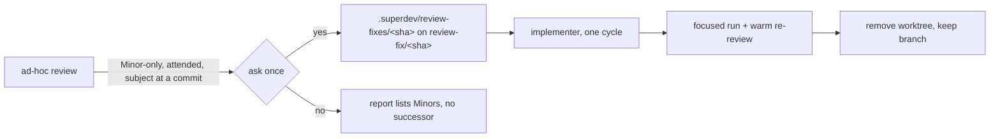

# 0227: An ad-hoc review fixes a Minor-only remainder inline

**Status:** Accepted

**Amends:** [ADR 0013](0013-implement-tail-is-a-command-chain.md): review stays read-only on an ad-hoc range
except for the inline fix below, which runs only on the operator's yes.

## Context

An ad-hoc `/superdev:review` applies nothing, and its Next block names `/superdev:plan` whenever a finding
stands, a Minor-only remainder included. A few-line fix then costs a plan, a scope branch, a pull request,
ship, and wrap-up. An adopter's ad-hoc review of `main` left 7 Minors and became about 8 sessions. A scope
review already fixes Minors inline after its ask-once. A scope review also treats `simplicity-reviewer` cuts
as advisory, while the full tier's per-slice loop already turns each warranted cut into a Minor.

## Decision

1. **An attended ad-hoc review offers to fix a Minor-only remainder inline.** The offer stands when every
   finding is Minor, warranted cuts included, and the subject ends at a commit: a range, a branch, a
   committed path diff, or standing code. A subject with uncommitted changes gets no offer. `--chained` and
   `--unattended` stay read-only, and the yes is the consent to write.
2. **The fix never touches the operator's checkout.** It lands on a fresh branch `review-fix/<short SHA>`,
   cut from the reviewed tip into a worktree under the main working tree's `.superdev/review-fixes/`, the
   one area `tree-guard.js` lets an implementer write to while a run exists. Review removes a clean worktree
   at its end and keeps the branch. It merges, pushes, and opens nothing.
3. **One dispatched implementer fixes, in one cycle.** The controller applies no fix. A focused run in the
   fix worktree and a warm re-review of the fix range close the cycle. No second cycle and no full-suite run
   follow.
4. **A Minor-only remainder never names `/superdev:plan`.** A Critical or Important finding still does, and
   gets no inline fix.
5. **A warranted cut is a Minor in every review fix set.** A scope review warrants each cut by the rules the
   repository documents for itself, as `implement-full.md` does, and the warranted cuts join the ask-once set.
   Only the entry review dispatches `simplicity-reviewer`, so a cut never starts the next cycle.

## Considered options

- **Keep review read-only and change only the Next block.** The operator still fixes trivial findings by
  hand.
- **Review writes a single-slice plan and offers `/superdev:implement`.** It keeps store traceability, but a
  few-line fix still costs a scope branch, a pull request, ship, and wrap-up.
- **`/superdev:implement --findings` without a plan.** A second entry into implement weakens its contract
  (ledger, anchor, stage) for a small case.
- **Fix without asking under `--unattended`.** Every unattended run would leave branches and worktrees
  behind, a second write path without consent.
- **Commit straight onto the checked-out branch, `main` included.** It puts unreviewed commits on `main` and
  touches the operator's checkout.
- **A quick path through `/superdev:plan` that skips the interview.** It is heavier than any option above and
  still runs the whole chain.
- **Cut the fix branch from a commit of uncommitted changes.** The operator is still editing, and superdev
  would commit work in progress on their behalf.
- **A hook that confines the implementer to the fix worktree.** `test-guard.js` and `run-trace.js` know only
  `.superdev/scopes/`. Prose and the unchanged operator checkout carry the bound for a one-cycle Minor fix.
