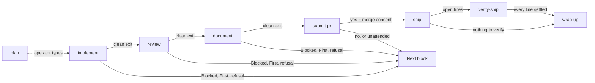

# 0253: The chain starts its successor, and the offer is removed

**Status:** Accepted

**Supersedes:** [ADR 0176](0176-the-offer-recommends-a-new-session.md),
[ADR 0183](0183-the-offer-proposes-the-new-session-as-a-card.md),
[ADR 0201](0201-the-offer-puts-up-the-card-first.md), [ADR 0213](0213-a-stop-hook-holds-the-offer.md),
[ADR 0216](0216-the-offer-guard-reads-a-next-step-without-its-heading.md),
[ADR 0222](0222-the-offer-guard-passes-the-running-skill.md),
[ADR 0223](0223-a-skill-adds-no-offer-condition-of-its-own.md),
[ADR 0225](0225-ship-runs-a-card-start-without-a-question.md),
[ADR 0226](0226-the-offer-guard-reads-only-the-last-paragraph.md), and
[ADR 0240](0240-the-offer-guard-reads-only-a-next-line.md).

**Amends:** [ADR 0013](0013-implement-tail-is-a-command-chain.md), whose commands stay separate but no
longer pause between implement and submit-pr. [ADR 0157](0157-every-chain-command-offers-to-start-its-successor.md), whose offer is removed.
Ship stays model-invocable, and ship still starts verify-ship. [ADR 0224](0224-verify-ship-starts-wrap-up-when-every-line-settles.md),
whose wrap-up ends the chain on its Next block and makes no offer.

## Context

Every covered command ends with an offer to start its successor (ADR 0157). In the Claude desktop app the
offer is a New task card that starts the successor in a linked session (ADR 0176, ADR 0183, ADR 0201). A
Stop hook, `hooks/offer-guard.js`, holds a turn that skipped the offer (ADR 0213), and four later ADRs
narrowed what it reads (0216, 0222, 0226, 0240).

Transcripts of 314 sessions in four repositories, 2026-11-10 to 2026-11-17, show the cost:

- A linked session wakes the session that started it on every turn it ends. Parents relayed 726 such
  turns, about 16% of main-session tokens.
- offer-guard held 144 turns. About 35% of the holds were false positives.
- A scope took 6 to 8 sessions, and the operator typed the step between them: "reviewed, ship",
  "Mark ready", "Wrap it up".

A chain command reads its state from its arguments and the run root (INV-0172), so a long conversation
costs tokens and breaks nothing. Verify-ship already starts wrap-up through the Skill tool in the same turn
with no question (ADR 0224), and ship already starts verify-ship.

## Decision

1. **A chain command starts its successor at its clean exit.** `/superdev:implement` starts
   `/superdev:review`, review starts `/superdev:document`, and document starts `/superdev:submit-pr`,
   each through the Skill tool in the same turn, with the arguments its Next block would print. It asks no
   question first and prints nothing after the started command returns. The started command owns the last
   message.
2. **Submit-pr asks for ship.** It asks one `AskUserQuestion`. A yes is the merge consent and starts
   `/superdev:ship` in the same turn. A no ends on the Next block that names `/superdev:ship <scope>`.
   Ship's route to verify-ship starts `/superdev:verify-ship`, and its route to wrap-up starts
   `/superdev:wrap-up`, in the same turn. Its repair and re-verify routes print their command. Verify-ship
   starts wrap-up at its settled exit (ADR 0224). The merge yes carries the scope to its close. A command
   that starts its successor names no staged pages on that exit, and the chain's last message names them,
   whether verify-ship or wrap-up ends it, a refusal or a stop included.
3. **A stop ends the chain.** A `Blocked:` line, a `First:` wait, a refusal, or a start the Skill tool
   refuses or fails ends the chain on the Next block of the command that stopped.
4. **An unattended run chains to submit-pr.** It carries `--unattended` to every command it starts and
   ends at submit-pr, which asks no ship question.
5. **A command typed partway through chains from there.** A command started by plan's own step, such as
   setup, still hands control back to plan.
6. **Plan starts nothing.** It ends on its Next block, and the operator starts implement in a fresh session.
7. **The offer is removed.** No command puts up a card, calls the session tool, or asks a Start or Stop
   question. Every covered command still ends on its Next block. `hooks/offer-guard.js`, `lib/offer-marker.js`,
   and `lib/running-skill.js` are deleted. No hook enforces the start in item 1.
8. **A brief start of ship asks one yes.** Ship, verify-ship, and wrap-up may start from another
   session's brief. Ship started that way asks the operator one `AskUserQuestion` confirming the command
   before any write, because a brief is never merge consent. Every other start of the three asks no extra
   question.

## Considered options

- **Drop the offer and chain nothing.** Every command prints its Next block only. This is the smallest
  change, but the operator still types every step.
- **Keep a slim guard that holds a missed chain start.** It brings back the hook, its markers, and the
  Next-block reading behind the false positives. A missed start costs the operator one typed command.
- **A `--step` argument that runs one command alone.** It keeps ADR 0013's pause as an explicit choice,
  at the cost of a flag in the parser and the prose. In the measured runs the operator never paused between
  implement and submit-pr. The operator stops the chain by interrupting it.
- **Plan starts implement after Release now.** Implement would carry the interview's context, and it reads
  none of it. Typing one command per feature also gives the operator a point to read the issues first.
- **Keep a plain Start or Stop question outside the chain.** This keeps an offer rule and its exceptions
  in the prose, to save one typed command at brainstorm, sweep, review-tests, and wrap-up.

## Consequences

- One conversation runs a scope from implement to wrap-up. It grows, and compaction can occur mid-chain.
  Run state survives compaction, because it lives in the run root.
- superdev starts no session, so no linked session wakes the session that started it.
- A model that ends its turn at a clean exit without starting the successor leaves the operator one
  command to type, the one its Next block prints.
- An external driver of `--unattended` runs makes one call per scope, not one per command.
