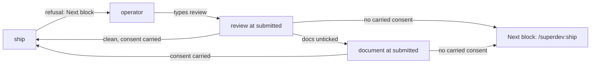

# 0268: The repair loop after a ship refusal chains to ship

**Status:** Accepted

**Amended by:** [ADR 0280](0280-ship-waits-for-the-named-checks-through-one-bounded-verb.md), whose ship waits on CI after its push.

**Amends:** [ADR 0253](0253-the-chain-starts-its-successor-and-the-offer-is-removed.md), whose chain start
covers only the first pass to submit-pr. Review and document on a scope at `submitted` now start their
successor too.

## Context

`/superdev:ship` refuses on a failed named check, a base-merge conflict, or a red local suite, and points
at `/superdev:review`. On a scope at `submitted`, review and document then print their next command and
start nothing (ADR 0253, item 1 covers only the pass that ends at submit-pr). On 2026-11-20, PR #304 and
PR #305 each needed three typed steps after ship refused: review, document, and ship.

The operator already gave merge consent by starting ship. The run trace keeps that start: every ship
refusal writes a `ledger step block ship` line.

## Decision

1. **A clean review at `submitted` starts its successor.** It starts `/superdev:document` when it unticked
   the `docs` line, and `/superdev:ship` otherwise.
2. **Document at `submitted` starts `/superdev:ship`.**
3. **A start of ship needs carried consent.** Consent carries when the latest ship step after the last
   submit step ended blocked. A later ship step that ended any other way withdraws it. The clean exits of
   review and document do not withdraw it. A read-only `scope.js` verb decides it from the run root, so a
   start behaves the same after `/clear` or in a new session (INV-0172). An absent or unreadable trace, a
   trace with no submit step, and a trace that differs from its digest carry no consent. A writing `scope.js`
   verb seals a trace edited outside `scope.js` again and records a `tamper trace.log` line, so a trace with
   that line after the last submit step carries no consent either. Without carried
   consent, review and document print `/superdev:ship` as before.
4. **Declining ship's entries-standing question withdraws consent.** That exit clears the step instead of
   blocking it, so the verb never reads a decline as consent.
5. **Ship's refusals stay stops.** A failed check, a conflict, a red suite, or a collision prints its
   command and starts nothing. A started ship keeps every gate it has when typed. On the CI path it pushes
   the new tip and refuses as pending, because ship never waits on CI (ADR 0255). A started ship whose
   deploy gate shows a changed posture, target, or named-check list asks the operator once before it
   merges, because a fix cycle made that change after the consent.
6. **Unattended runs and ad-hoc reviews start no ship.** Ship refuses `--unattended` (INV-0093).

## Considered options

- **A fresh yes before every ship start.** Review and document would chain to each other and end on the
  ship Next block. It keeps a merge of fix-cycle code from happening without a new yes. The operator
  already consented, and on the CI path the started ship can only push and stop as pending.
- **Ship's refusal starts review.** It saves one more typed command. On PR #304 the red check came from
  base, and its fix landed on main in a separate pull request (#303). A review started at once would have
  fixed base's test inside the scope. It would also let a repair with no new commit loop between ship and
  review.
- **Consent read from the conversation.** It needs no verb. A started command takes its state from its
  arguments and the run root (INV-0172), and a conversation does not survive `/clear`.

## Consequences

- A scope whose ship refused needs one typed command to repair, and one more on the CI path, once the
  checks on the pushed tip are green.
- On the local path, a started ship runs the suite on the repaired tip and merges on green, with no
  further question.
- A scope where the operator typed review at `submitted` before any ship ran keeps today's printed ship.
- Below `submitted`, nothing changes: a review whose `docs` untick leaves the stage at `documented` still
  prints `/superdev:document`.
- Known limits. The trace records no caller, so a subagent that runs `scope.js step set ship` and
  `step block` itself writes a consent the verb accepts. A trace append that fails is silent, so a lost
  withdrawal line reads as consent. An adopted run keeps a local trace over the ref's newer one. A merge
  call the permission classifier denies stops ship each time a repair starts it again. A run that declined
  ship's entries-standing question under an earlier release recorded `step block` with the ship step
  standing, so after an upgrade it reads as carried consent, and a clean review starts ship.
