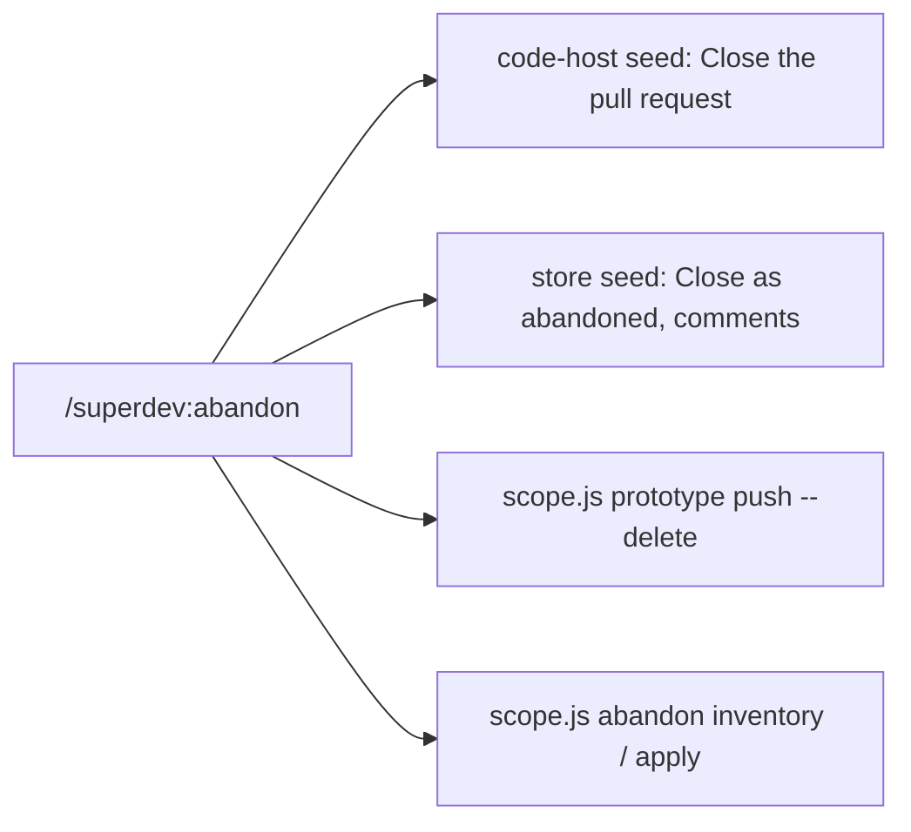

# 0288: Abandon is an operator command over a local teardown verb

**Status:** Accepted

**Amends:** [ADR 0208](0208-deleting-run-state-is-a-write.md), whose `discard` stays the planned-only removal, and
[ADR 0274](0274-wrap-up-offers-to-delete-the-scope-branch.md), whose containment gate stays wrap-up's. It also amends
ADR 0287's consequence that a run that never reaches wrap-up keeps its prototype branches on the remote.

**Context.** An operator who drops an idea mid-way has no way out of the run. Wrap-up needs a merged pull request and
a settled Definition of Done, and `discard` refuses past `planned`. So the run's branches, worktrees, records, and run
root stay behind and `/superdev:status` keeps listing them.

**Decision.** `/superdev:abandon <target>` is operator-only (`disable-model-invocation: true`). Its target is a local
intent file, an intent record, or a run from `planned` through `submitted`. It shows one inventory of every item it
removes or closes, marks each item that would lose work, and asks one "You sure?" question. A new
`scope.js abandon` verb owns the local half. `abandon inventory` prints the local items and a `token` line hashing
them. `abandon apply --token <hash>` recomputes the inventory and deletes nothing when the hash differs. It removes
worktrees by force, deletes branches locally and on the remote whether or not base contains them, each under a lease on
the tip it read, deletes the run-state ref, and removes the run root last. Prose owns the calls that reach a backend,
in this order: close the pull request (a new code-host seed call), close the records as abandoned (a new
**Close as abandoned** store seed call), comment on absorbed and intent records, then call the verb. Recorded
prototype branches go through `scope.js prototype push --delete`. Nothing goes to a trash: the confirm is the only
safety.

**Considered options.**

- *Flags on existing verbs* (`discard --abandon`, `branch delete --uncontained`). This needs less new code. It lost
  because the destructive path would span three verbs, and the worktree and slice-branch removals would stay prose
  `git` calls that no suite tests.
- *One `scope.js abandon` verb that does the whole teardown.* It lost because store and host calls are prose driven by
  the pluggable backend seeds, so no CLI can own the record and pull-request closes.
- *An `--abandon` mode of `/superdev:wrap-up`.* It lost because it needs exceptions to the rules that keep wrap-up safe:
  start only once shipped, delete the scope branch only when base contains it, never force-remove a tree.
- *A TTL reaper hook that marks a run abandoned.* It lost because hooks make no host or store call (ADR 0007, ADR 0023),
  so it cannot close the pull request or the records.
- *Archive refs and a stash snapshot of each dirty worktree for recovery.* It lost because the operator chose a clear
  confirm over a recovery path.
- *An inventory file that `apply` reads.* It saves a recompute. It lost because a stale file from an earlier inventory
  could authorize a later apply.
- *The OS trash for local files.* It makes drafts recoverable. It lost because git refs, worktrees, and remote branches
  have no trash, and a trash differs on every platform the hooks run on.

**Consequences.** A run abandoned mid-way leaves no run root, so status, `candidates`, and prune stop seeing it. The
report names each deleted branch and its tip, so the work is recoverable from the reflog or the remote's history only.
A teardown interrupted by a failed backend call is completed by running abandon again, because the run root goes
last. Another clone of the repository keeps its own run root.
