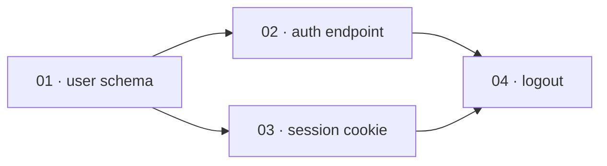

# Plan authoring

The rules `/superdev:plan` writes a plan by: how a Definition-of-Done criterion is worded, the `Reachable:` and
`Release risk:` criteria every Definition of Done carries, the epic's advisory sections, how a feature is cut into
vertical slices, where a `fix` feature's reproduction lands, and how an append extends a feature that already has
slices. `/superdev:plan` reads this file. `plan-contract.md` holds the slice schema, the criterion line format, the
lifecycle, and the scope anchor these rules write into.

## Writing a criterion

**Behaviour, not a proxy.** Applies to every `acceptance` criterion and every Definition-of-Done criterion. State
**observable, user-facing behaviour**, never a gameable proxy count (coverage %, line count, lint score). A proxy
count may appear as a signal a reviewer reads, never as a gate an agent optimizes toward.

**A requirement, not a procedure.** Applies to every criterion. State a requirement the feature meets. Name no command
superdev runs to check it.

- **`Reachable:`** is the standing exception: it names the entrance a user reaches the feature through, never a
  verification step.

**The reader's vocabulary.** Applies to every Definition-of-Done criterion. Write the behaviour the feature delivers,
never how it is built. A file path, an invariant register id, or a verification procedure belongs to the delivering
slice's `spec` and `acceptance`, never to the epic.

- The epic states what an invariant protects, never the id of the entry that requires it.

### The reachability criterion

**The `Reachable:` line.** Applies to every feature's Definition of Done, on every change type. It carries at least
one criterion **led by `Reachable:`**, naming the entrance a user reaches the feature through (an endpoint, a
command, a screen) in the interface vocabulary of the `spec` field. It names no file path and no test file: the test
that proves it is the implementer's choice (**Negotiable**).

```
- [ ] Reachable: POST /orders (OrderApi) returns 201 and persists the order
- [ ] Reachable: the checkout page's Place Order button calls POST /orders
- [ ] Reachable: none — published SDK, consumers are external
```

- **A feature no in-repo consumer calls** → `Reachable: none`, with the reason. A bare `none` is no answer.
- **A behaviour-preserving refactor** → `none — entrance unchanged`.
- **A prose feature** → the surface that reaches the running system: a skill step that runs, a reference a surface
  is routed to read, a checklist section a named agent applies. A reference nobody routes to is dead code.

**Feature-level.** Applies to where the line sits. A single-slice feature carries it in the lone slice's
`acceptance`, and no slice gains a `Reachable:` criterion of its own. **Append mode** adds a further `Reachable:`
criterion for the extension and edits no existing one.

**An entrance not reachable yet.** Applies to a feature whose entrance nothing reaches today. Making it reachable is
one of the plan's slices, in the consuming workspace when that is a different one from the feature's own. The
criterion covers an orphan inside one process. An endpoint no client calls across a process boundary needs the
consuming side's own slice.

### The release-risk criterion

**The `Release risk:` lines.** Applies to every plan and every change type: a new feature, an append, a repair `fix`
feature, and a single-slice feature, whose lone slice's `acceptance` carries the lines. The Definition of Done carries
at least one criterion **led by `Release risk:`**. It names each release-risk category in exactly one place: its own
`Release risk:` criterion, or one `Release risk: none — <category>: <reason>; …` line naming every category that does
not apply, each with its reason.

- Categories that share one reason may share it: `<category>, <category>: <reason>`.
- **Append mode** adds its own `Release risk:` lines for the extension and edits no existing one. A repair answers for
  its own change.
- The step runs on every plan, whatever its kind.

**A deploying feature.** Applies to the deploy-dependent categories: rollback, deploy-window data compatibility, and
production visibility. Each applies only to a **deploying feature**. Every other feature answers them `none`, with
that reason.

- **A recorded posture** → a deploying feature's deploy answer lists a recorded deploy target.
- **No recorded posture** (no `docs/agents/deployment.md`, or one with no `Posture:` line) → a deploying feature's
  answer to plan's once-per-plan question is that it reaches a running production system.

**The categories.** Applies to each category's own criterion.

- **Rollback path.** Applies to every deploying feature. The criterion states what undoing the release requires, and
  that the undo restores the previous behaviour.
- **Deploy-window data compatibility.** Applies to a deploying feature that changes persisted data or its schema. The
  criterion states that the previous release keeps working against the changed data while the deploy runs.
- **Consumer compatibility.** Applies to a feature that changes a name, format, or behaviour whose consumer the same
  merge does not update: an external user, another repository, data an older release wrote, a separately installed
  component of the same repository. It applies under any deploy posture. The criterion states that existing consumers
  keep working, or names the break and the migration those consumers need.
- **Production visibility.** Applies to a deploying feature that adds a production path, code a deploy target runs on
  a request, an event, or a schedule. The criterion states that a failure on that path reaches the operator through a
  named signal the repository has, or one the plan's slices add.

```
- [ ] Release risk: rollback — reverting the release restores the previous order flow; the new orders column stays nullable, so no data step is needed
- [ ] Release risk: consumer compatibility — the `v1` export format stays readable; the new field is optional for existing importers
- [ ] Release risk: none — deploy-window data compatibility: no persisted data changes; production visibility: no new production path
```

**A `none` reason's ending.** Applies to every `none` reason. End it with no ` — <tag>`-shaped segment (` — scope`,
` — 02`, ` — #12`). The DoD-line parser takes the rightmost such segment of an unjudged line as its tag
(`plan-contract.md`'s `### Criterion tags`).

**No procedure here either.** Applies to every `Release risk:` criterion. State a requirement the feature meets, and
name no command superdev runs to verify it. A rollback criterion states what an undo requires and never asks
`/superdev:ship` or `/superdev:verify-ship` to run one.

- **A criterion only a deployed system can show** stays in the Definition of Done, unticked, until
  `/superdev:verify-ship` observes it after the deploy (`references/scope-mode.md`'s `## Verification ceiling`).

## Parked questions and non-goals

**Parked questions.** Applies to a load-bearing decision a multi-slice plan's interview could not resolve. Write it
to the epic's `## Parked questions` section the moment it is parked (`cross-exam.md`'s termination rule permits ending
an interview this way). It is advisory.

- **Advisory** → `/implement` never reads it, nothing gates on it, and it adds no lifecycle status.
- **A single-slice plan** parks nothing: an unresolved load-bearing decision there means the plan is not
  single-slice yet.

**Non-goals.** Applies to something deliberately not being built, from the interview's own scoping or routed from a
seeded intent's rejected scope (`domain-modeling.md`). On a multi-slice plan, write it to the epic's `## Non-goals`
section. It is advisory: `/implement` never reads it.

- **A single-slice plan** writes no epic, so it names the exclusion in the lone slice's `spec`.

## Epic visuals (optional, epic-only)

**The two visuals.** Applies to an epic whose plan shape defeats a numbered list. `/plan` may add `## Slice graph`
and `## Touch map`, both for human readers and both **advisory**. They are markdown only, and the epic carries no
HTML.

- **Advisory** → `/implement` never reads them, no review agent gates on them, and neither adds a lifecycle status.
- The design sketch (`design-sketch.md`) is a separate, throwaway file outside the epic.

**`## Slice graph`.** Applies to the graph section. Draw a mermaid `flowchart LR` of the plan's `depends-on` DAG, one
node per slice labelled `<id> · <title>`, one edge per `depends-on` entry:

````markdown
## Slice graph


````

**`## Touch map`.** Applies to the map section. Write a fenced plain-text tree of the files the plan touches, naming
the slices that touch each one and marking every file that slices **able to run in parallel** both edit. It is
evidence for the dependency order, never an instruction.

````markdown
## Touch map

```
src/
  auth/
    login.ts       ← 02
    session.ts     ← 03
    logout.ts      ← 04
  db/schema.ts     ← 01
  index.ts         ← 02, 03   ⚠ parallel, barrel export, both add a line
```

`02` and `03` are the only pair with no dependency path between them, so `index.ts` is the only
collision — every other file is touched by one slice, or by slices the graph already orders.
````

- **Never an instruction** → no slice `spec` gains a file path, and an implementer that touches a file the map did not
  predict has done nothing wrong.

### When to write them

**The gate.** Applies to every plan with an epic.

- **Floor.** A plan `/implement` would run at the **`lite` tier** gets neither section. The floor is the tier
  boundary itself.
- **`## Slice graph`**, above the floor → write it when the graph is **not a single chain**: some slice has two or
  more dependencies, or two slices have no dependency path between them. A chain of any length stays a numbered list.
- **No `depends-on` anywhere**, above the floor → write the graph: a diagram with no edges shows that everything is
  parallel.
- **`## Touch map`**, above the floor → write it when slices that **can run in parallel** edit a common file, and
  omit it otherwise.
- The two are independent: a plan can warrant one and not the other.

**The verdict line.** Applies to every plan the gate judges. `/plan` **states the verdict** in one line either way,
such as "7 slices, two parallel branches colliding on `src/index.ts` — writing both sections", or "5 slices, straight
chain — numbered list is clearer, skipping both".

- **A single-slice plan** writes no epic and gets neither section.
- **A slice store that renders neither mermaid nor HTML** shows the graph as a fenced code block. The touch map is
  plain text and unaffected.

## Vertical-slice rules (how `/plan` must slice)

**The slice rules.** Applies to every slice `/plan` cuts.

- Each slice is a **tracer bullet**: a narrow but COMPLETE path through every layer (schema → API → UI → tests),
  demoable and verifiable on its own.
- Each slice leaves the suite **green on its own**.
- A slice depends on another **only if it cannot be green without it**.
- **Negotiable** — the `spec` states intent and the end-to-end behaviour and leaves the implementer room on the *how*:
  a contract of outcomes, not a line-by-line script.
- **Estimable** — a slice a fresh reviewer could not size in one pass is too big or too vague: decompose it until each
  slice is a unit you could gate on its own.

### A fix feature's reproduction

**The reproduction slice.** Applies to a feature whose change type is `fix`. Its **red-capable command**, one
invocation that reproduces the defect and has run once (`diagnosis.md`'s `## The red-capable command (the gate)`), is
the first acceptance criterion of a `behavior` slice. Every other `behavior` slice of the feature depends on that
slice, directly or through other slices. This dependency is the one exception to the slice rules' `depends-on` rule.

- **A defect nobody can reproduce yet** → building that command is the work of that slice.
- **A `fix` feature with no `behavior` slice** → its first slice's `spec` states why no command reproduces the defect,
  and the feature carries no red-capable criterion.

### Wide refactors (expand–contract)

**Expand–contract.** Applies to a **wide refactor**, one mechanical change whose blast radius fans across the codebase
(rename a column, retype a shared symbol), where no narrow path through every layer exists. Sequence it as
expand–contract in place of tracer-bullet slices:

1. **Expand** — add the new form beside the old, so nothing breaks. One slice, green.
2. **Migrate** — move call sites over in batches sized by blast radius (per package, per directory), each batch its
   own slice with `depends-on` the expand slice. Each batch green.
3. **Contract** — delete the old form once no caller remains, in a slice that `depends-on` every migrate batch.

- Every one of these slices stays independently green, so the ordinary rules and gates hold. The batches are usually
  `mechanical`.

**The integration branch.** Applies to a wide refactor whose batches cannot stay green alone. Green is promised at
one node instead of per slice. The epic carries an `## Integration branch` section naming `integration/<scope>`, and
the full playbook merges every slice into that branch, which keeps the scope branch green between invocations.

- **A final integrate-and-verify slice**, depending on every batch, merges `integration/<scope>` into the scope branch
  with an explicit message file, as `implement-full.md`'s **An epic carrying `## Integration branch`** states.
- The full-suite evidence `/superdev:ship` takes verifies that merge.

## Append mode

**Append mode.** Applies to `/superdev:plan` extending a feature that already has slices. Every backend renders each
invariant of this section. A slice's `id` is the key the backend's server assigns at creation, so append names no
numbering rule of its own.

**Merged slices are immutable.** Applies to every merged slice's issue. Append never edits, renumbers, closes, or
deletes it. The anchor lines that migrate when append promotes a single-slice feature are the one exception
(**Extending a single-slice feature creates the epic first**).

**Ids are never reused or renumbered.** Applies to every new slice. A new slice's `depends-on` may name an
already-merged slice's `id` as a satisfied root.

**The global Definition of Done is amended in place, never replaced.** Applies to the epic's checklist. Append new
criteria to it, each tagged with the new slices' ids, which continue the running id sequence, or `scope`
(`plan-contract.md`'s `### Criterion tags`). A criterion merged slices already satisfy is never removed.

**Extending a single-slice feature creates the epic first.** Applies to an append onto a feature with no epic. Copy
the lone slice's `acceptance` into a new epic as the global Definition of Done, amend it with the new criteria, and
leave the lone slice byte-identical.

- **The anchor lines** → the exception to byte-identical: each moves to the new epic and leaves the lone slice.
- The moving lines are the anchor dependency, the deploy line, the Repairs line, the Absorbs line, and the Intent line
  (`plan-contract.md`'s `## Scope anchor`). Nothing else about the slice changes.
- Two slices under one feature label with no epic is the shape a store's `## Scope anchor` section calls
  **Ambiguous**.

**An active run refuses.** Applies to an append while a run is active. Append refuses and writes nothing.

**A join edits no sibling's line.** Applies to an append that joins a shared anchor (`plan-contract.md` → *A shared
anchor*). It appends this repository's own slices and lines, and leaves every other repository's line and the
anchor's release signal as they stand. The one edit to another repository's lines is the qualify step, which names
the first repository's component in its plain `scope` and `docs` tags when the join makes the anchor shared
(`plan-extend.md`'s **Joining a shared anchor**). The active-run signal reads this repository's own slices only.

**A shipped or closed feature takes no append.** Applies to every append. `/superdev:plan`'s extend path refuses on
any one shipped signal alone, and names the remedy. A failed read of the anchor body refuses too.

- **The shipped signals** → a run root whose ledger stage reads `shipped` or `closed`; a scope anchor at the store's
  done status; an anchor whose `## Run state` snapshot stage reads `shipped` or `closed`, read off the anchor body the
  extend path already loaded.
- **A snapshot-less store, or an anchor with no `## Run state` section** → the other two signals decide.
- **The remedy** → a new feature carrying the anchor dependency `**Blocked by feature:** #<anchor>`
  (`plan-contract.md`'s `## Scope anchor`), opened now.
- **A shipped feature holding a `not met:` line** → `/superdev:plan`'s repair choice is the remedy instead.
- **Its `not met:` notes all lacking `/superdev:verify-ship`'s repair citation** → name `/superdev:verify-ship
  <scope>` first.

**The run root's stage.** Applies to an append onto a feature with a run root. A `planned` run root takes the append,
which revises the plan before any slice ran. A run root at every stage from `implementing` on refuses, `submitted`,
`shipped`, and `closed` included, with the same new-feature remedy.
