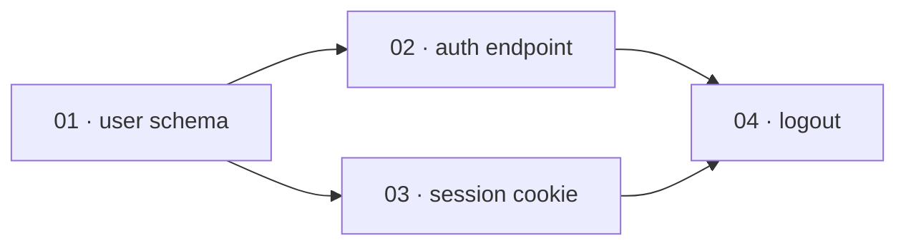

# Plan authoring

The rules `/superdev:plan` writes a plan by: how a Definition-of-Done criterion is worded, the
`Reachable:` and `Release risk:` criteria every Definition of Done carries, the epic's advisory sections,
how a feature is cut into vertical slices, and how an append extends a feature that already has slices.
`/superdev:plan` reads this file. `plan-contract.md` holds the slice schema, the criterion line format,
the lifecycle, and the scope anchor these rules write into.

## Writing a criterion

Both `acceptance` and the DoD state **observable, user-facing behaviour** — not gameable proxy counts
(coverage %, line count, lint score). Behaviour can't be faked without doing the work; a count can. Where
a proxy count appears at all it's a signal a reviewer reads, never a gate an agent optimizes toward.

A criterion states a requirement the feature meets, never a procedure superdev executes to verify it: it
names no command superdev runs to check it. `Reachable:` below is the standing
exception, because it names the entrance a user reaches the feature through, never a verification step.

A DoD criterion is written in the reader's vocabulary: the behaviour the feature delivers, not how it is
built. A file path, an invariant register id, or a verification procedure belongs to the slice that
delivers it — its `spec` and `acceptance` — never to the epic. The epic states what an invariant protects,
never the id of the entry that requires it.

### The reachability criterion

Every feature's Definition of Done carries at least one criterion **led by `Reachable:`**, naming the
entrance a user reaches the feature through — an endpoint, a command, a screen — in the interface
vocabulary the `spec` field already uses. It names no file path and no test file: which test proves it is
the implementer's to choose, exactly as **Negotiable** below already says. A feature no in-repo consumer
calls answers `Reachable: none` and states why, because a bare `none` reads exactly like the oversight the
criterion exists to catch.

```
- [ ] Reachable: POST /orders (OrderApi) returns 201 and persists the order
- [ ] Reachable: the checkout page's Place Order button calls POST /orders
- [ ] Reachable: none — published SDK, consumers are external
```

The rule holds on **every change type**. A behaviour-preserving refactor answers `none — entrance
unchanged`. A prose feature names the surface that reaches the running system as its entrance — a skill
step that runs, a reference a surface is routed to read, a checklist section a named agent applies — since
that is how prose reaches anything at all; a reference nobody routes to is dead code. Staying uniform leaves `/plan` no judgment about whether
the rule fires.

It is **feature-level**. A single-slice feature carries it in the lone slice's `acceptance`, which is
already that feature's Definition of Done, so no slice gains a criterion of its own. **Append mode** adds
a further `Reachable:` criterion for the extension rather than editing an existing one, which the
amend-in-place invariant below already requires.

Where the entrance is not reachable yet, making it reachable is one of the plan's slices — in the
consuming workspace when that is a different one from the feature's own. The criterion covers an orphan
inside one process, where the composition root never registers the symbol. It does not see across a
process boundary: an endpoint no client calls leaves both sides green, and the consuming side's own slice
is what covers that.

### The release-risk criterion

Every feature's Definition of Done carries at least one criterion **led by `Release risk:`**. It answers
the release-risk categories below — rollback path, deploy-window data compatibility, consumer
compatibility, production visibility — and names each category in exactly one place: its own
`Release risk:` criterion, or one `Release risk: none — <category>: <reason>; …` line naming every
category that does not apply, each with its reason. Categories that share one reason may share it:
`<category>, <category>: <reason>`.

Rollback, deploy-window data compatibility, and production visibility are the deploy-dependent
categories. Each applies only to a **deploying feature**: one whose deploy answer lists a recorded deploy
target, or, in a repository with no recorded posture (no `docs/agents/deployment.md`, or one with no
`Posture:` line), one whose answer to plan's once-per-plan question is that it reaches a running
production system. Every other feature answers them `none`, with that reason.

- **Rollback path.** Applies to every deploying feature. The criterion states
  what undoing the release requires, and that the undo restores the previous behaviour.
- **Deploy-window data compatibility.** Applies to a deploying feature that changes persisted data or its
  schema. The criterion states that the previous release keeps working against the changed data while the
  deploy runs.
- **Consumer compatibility.** Applies to a feature that changes a name, format, or behaviour whose
  consumer the same merge does not update: an external user, another repository, data an older release
  wrote, a separately installed component of the same repository. It applies under any deploy posture.
  The criterion states that existing consumers keep working, or names the break and the migration those
  consumers need.
- **Production visibility.** Applies to a deploying feature that adds a production path — code a deploy
  target runs on a request, an event, or a schedule. The criterion states that a failure on that path
  reaches the operator through a named signal the repository has, or one the plan's slices add.

```
- [ ] Release risk: rollback — reverting the release restores the previous order flow; the new orders column stays nullable, so no data step is needed
- [ ] Release risk: consumer compatibility — the `v1` export format stays readable; the new field is optional for existing importers
- [ ] Release risk: none — deploy-window data compatibility: no persisted data changes; production visibility: no new production path
```

A `none` reason never ends in a ` — <tag>`-shaped segment (` — scope`, ` — 02`, ` — #12`): the DoD-line
parser takes the rightmost such segment of an unjudged line as the line's tag (`plan-contract.md`'s `### Criterion tags`).

Every `Release risk:` criterion states a requirement the feature meets and names no command superdev runs
to verify it, as every criterion does. A rollback criterion states what an undo requires; it
never asks `/superdev:ship` or `/superdev:verify-ship` to run one. A
`Release risk:` criterion only a deployed system can show stays in the Definition of Done, unticked, until
`/superdev:verify-ship` observes it after the deploy (`references/scope-mode.md`'s `## Verification ceiling`).

The rule holds on **every plan and every change type**: a new feature, an append, a repair `fix`
feature, and a single-slice feature, whose lone slice's `acceptance` carries the lines. **Append mode**
adds its own `Release risk:` lines for the extension rather than editing an existing one, and a repair
answers for its own change. Staying uniform leaves `/plan` no judgment about whether the step runs, so a
skipped pass never reads like a pass that found nothing to name.

## Parked questions and non-goals

**Parked questions** (optional, epic-only). A load-bearing decision the interview couldn't resolve,
written to the epic the moment it's parked (`cross-exam.md`'s termination rule permits ending an interview
this way). Purely advisory — `/implement` never reads it, nothing gates on it, no new lifecycle status.
Single-slice plans carry no equivalent: an unresolved load-bearing decision there signals the plan isn't
single-slice-simple yet, not something to park.

**Non-goals** (optional, epic-only). Something deliberately not being built — from the interview's own
scoping, or routed here from a seeded intent's rejected scope (`domain-modeling.md`). Advisory, like
parked questions: `/implement` never reads it. Single-slice plans write no epic, so a deliberate
exclusion there is named in the lone slice's `spec` instead.

## Epic visuals (optional, epic-only)

Two sections `/plan` may add to the epic when the plan's shape defeats a numbered list. Both are for
human readers of the epic; both are **advisory**, exactly like `Parked questions` — `/implement` never
reads them, no review agent gates on them, and neither adds a lifecycle status. The epic's own visuals
are markdown only: superdev ships no renderer, and the epic itself carries no HTML. The design sketch
(`design-sketch.md`) is a separate, throwaway file outside the epic.

**`## Slice graph`** — a mermaid `flowchart LR` of the plan's `depends-on` DAG, one node per slice
labelled `<id> · <title>`, one edge per `depends-on` entry:

````markdown
## Slice graph


````

**`## Touch map`** — a fenced plain-text tree of the files the plan touches, naming the slices that
touch each one and marking every file that slices **able to run in parallel** both edit. It is the
evidence for the dependency order, not an instruction: no slice `spec` gains a file path (the `spec`
field rule and **Negotiable** both still hold), and an implementer that touches a file the map didn't
predict has done nothing wrong.

````markdown
## Touch map

```
src/
  auth/
    login.ts       ← 02
    session.ts     ← 03
    logout.ts      ← 04
  db/schema.ts     ← 01
  index.ts         ← 02, 03   ⚠ parallel, barrel export, both add a line
```

`02` and `03` are the only pair with no dependency path between them, so `index.ts` is the only
collision — every other file is touched by one slice, or by slices the graph already orders.
````

### When to write them

- **Floor.** A plan `/implement` would run at the **`lite` tier** gets neither section, ever — such a
  plan is too small to have a shape worth drawing. The floor *is* the tier boundary; it is not a second
  number to keep in sync.
- Above the floor, write `## Slice graph` when the graph is **not a single chain** — some slice has ≥2
  dependencies, or two slices have no dependency path between them. A chain of any length is a numbered
  list, and drawing it is noise.
- A plan above the floor with no `depends-on` anywhere still earns the graph: a diagram with no edges is
  correct, not empty — it communicates "everything is parallel".
- Above the floor, write `## Touch map` when slices that **can run in parallel** edit a common file.
  With no parallel overlap the map has nothing to report; omit it.
- The two are independent: a plan can warrant one and not the other.
- `/plan` **states the verdict** in one line either way, so the judgment is visible and overridable —
  "7 slices, two parallel branches colliding on `src/index.ts` — writing both sections", or "5 slices,
  straight chain — numbered list is clearer, skipping both".

Single-slice plans carry no equivalent: they write no epic at all, and they are under the floor anyway.
A slice store that renders neither mermaid nor HTML shows the graph as a fenced code block — legible,
unrendered; the touch map is plain text and unaffected.

## Vertical-slice rules (how `/plan` must slice)

- Each slice is a **tracer bullet**: a narrow but COMPLETE path through every layer (schema → API → UI
  → tests), demoable/verifiable on its own.
- Each slice leaves the suite **green on its own**.
- A slice depends on another **only if it cannot be green without it** — keep the graph honest, or you
  serialize work that could run in parallel.
- **Negotiable** — the `spec` states intent and the end-to-end behaviour and leaves the implementer room
  on the *how*; it is a contract of outcomes, not a line-by-line script.
- **Estimable** — a slice a fresh reviewer couldn't size in one pass is too big or too vague: decompose
  it further until each slice is a unit you could gate on its own.

### Wide refactors (expand–contract)

A **wide refactor** — one mechanical change whose blast radius fans across the codebase (rename a
column, retype a shared symbol) — is the exception to tracer-bullet slicing: no narrow path through
every layer exists. Don't force one; sequence it as **expand–contract**:

1. **Expand** — add the new form beside the old, so nothing breaks. One slice, green.
2. **Migrate** — move call sites over in batches sized by blast radius (per package, per directory),
   each batch its own slice with `depends-on` the expand slice. Each batch green.
3. **Contract** — delete the old form once no caller remains, in a slice that `depends-on` every
   migrate batch.

Every slice above stays independently green, so the ordinary rules and gates all hold; the batches are
usually `mechanical`, so the per-slice reviews are already skipped. **When even the batches cannot stay
green alone**, green is promised at one node instead of per slice: the epic carries an
`## Integration branch` section naming `integration/<scope>`, the full playbook merges every slice into
that branch, which keeps the scope branch green between invocations, and a final
**integrate-and-verify** slice, depending on every batch, is where `integration/<scope>` merges into the
scope branch. The scope review's exit run verifies that merge.

## Append mode

`/superdev:plan` can also **extend** a feature that already has slices, instead of planning a new one.
Append mode holds these invariants, and every backend renders all of them:

- **Merged slices are immutable.** Append never edits, renumbers, closes, or deletes a merged slice's
  issue — except the anchor-dependency line, which migrates to the new epic when append promotes
  a single-slice feature (*Extending a single-slice feature creates the epic first*, below).
- **Ids are never reused or renumbered.** A new slice's `depends-on` may name an already-merged slice's
  `id` as a satisfied root.
- **The global Definition of Done is amended in place, never replaced.** New criteria are appended to the
  checklist, tagged the same way as every other criterion (`plan-contract.md`'s `### Criterion tags`) with the new slices'
  ids — which continue the id sequence already running — or `scope`; a criterion merged slices already
  satisfy is never removed retroactively.
- **Extending a single-slice feature creates the epic first.** A single-slice feature has no epic — its
  lone slice's `acceptance` doubles as the global DoD (`plan-contract.md`'s `## Fields`), and the slice is its own scope
  anchor. Append copies that `acceptance` into the new epic as the global DoD, amends it with the new
  criteria, and leaves the lone slice byte-identical. Skipping this step would leave two slices under one
  feature label with no epic — the shape a store's `## Scope anchor` section calls **Ambiguous**, which
  cannot resolve into a root. **The anchor-dependency, deploy, Repairs, Absorbs, and Intent lines are the exceptions to
  byte-identical:** when the lone slice carries an anchor dependency (`plan-contract.md`'s `## Scope anchor`), that line **migrates to the new epic** — the epic is the anchor now,
  and the dependency is a property of the anchor, not of the slice — and is removed from the lone slice.
  The **deploy line** (`plan-contract.md`'s `## Scope anchor`) migrates the same way, for the same reason — it too is
  anchor-only, and is removed from the lone slice. The **Repairs line** (`plan-contract.md`'s `## Scope anchor`) migrates the
  same way, and is removed from the lone slice. So does the **Absorbs line** (`plan-contract.md`'s `## Scope anchor`), and so does the **Intent line**.
  Nothing else about the slice changes. Leaving any of them
  behind would strand it on a record `/superdev:status`, `/superdev:ship`, or `/superdev:wrap-up` no
  longer reads as this feature's anchor.
- **Append refuses, and writes nothing, while a run is active.**
- **A shipped or closed feature takes no append.** Amending a shipped feature's Definition of Done in place pools
  criteria verified against a merged pull request with criteria nobody has verified,
  and the run root's reap removes the local half of that mixture while the scope anchor keeps
  its own. `/superdev:plan`'s extend path refuses on any one of its shipped signals alone — a run root
  whose ledger stage reads `shipped` or `closed`, a scope anchor at the store's done status, and an anchor
  whose `## Run state` snapshot stage reads `shipped` or `closed`, which alone shows a feature shipped on
  another machine — and names the remedy: a new feature
  carrying the anchor dependency `**Blocked by feature:** #<anchor>` (`plan-contract.md`'s `## Scope anchor`). The snapshot
  is read off the anchor body the extend path already loaded. A failed read of the anchor body refuses too,
  because the gate fails closed on a state it cannot read; a snapshot-less store, or an anchor with no
  `## Run state` section, leaves the other two signals to decide. A shipped
  feature holding a `not met:` line gets `/superdev:plan`'s repair choice as its remedy instead, because
  that dependency waits for an anchor the standing line keeps open. One whose `not met:` notes all lack
  `/superdev:verify-ship`'s repair citation gets `/superdev:verify-ship <scope>` first, because the repair
  choice lists only a feature holding a note verify-ship observed. Appending at
  `planned` is unchanged: an earlier plan run cut the branch but no slice has run yet, so appending
  revises that plan before anything started. A run root from `implementing` through `documented` refuses
  too. That chain ends at `shipped`, which the rule above already refuses. Waiting clears nothing, and
  the remedy is the same new feature, opened now rather than waited for.

A slice's `id` is the key the backend's own server assigns at creation, which is already unique and
stable, so append names no numbering rule of its own.
