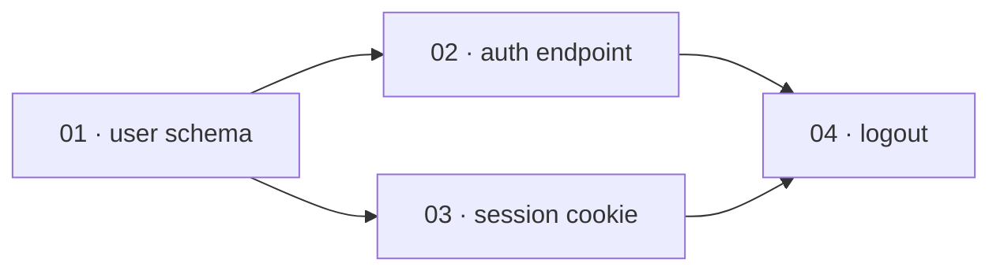

# Plan-file contract

The **logical schema** every superdev slice carries. `/superdev:plan` writes it; `/superdev:implement`
reads it. It is backend-agnostic: the local-file rendering is shown below; issue backends
(`issue-tracker-jira.md`, etc.) map the same fields onto issue bodies, links, and statuses.

## Fields

| Field | Meaning | Consumed by |
|---|---|---|
| `id` | Stable slice identifier — the local backend uses the zero-padded file number (`01`, `02`, …); an issue backend uses the issue key. | DAG ordering, status tracking |
| `title` | Short descriptive name. | humans |
| `depends-on` | List of slice `id`s that must merge before this slice can start. Empty = root. | `/implement` DAG |
| `test-applicability` | `behavior` \| `mechanical` \| `docs`. Drives the warrant gates (see below). | `/implement`, `implementer` |
| `spec` | What this slice delivers end-to-end — the implementer's requirements. Describe behavior and name the specific interface (a function signature, an API endpoint, a CLI command) its tests exercise — not file paths. Name the **domain shapes** the slice needs too, by name and in the project glossary's vocabulary, never as field lists: the implementer declares them before its first failing test and owns their fields (ADR 0030). One exception to interfaces-only: a prototype-produced snippet that encodes a decision more precisely than prose can (a state machine, a reducer, a schema) may be inlined, trimmed to the decision-rich parts and marked as prototype-sourced (`prototype.md`). | `implementer` |
| `acceptance` | Checkable criteria for THIS slice. On a `behavior` slice these name the domain-level failure and boundary cases too — those derivable from the interview without reading the implementation — not just the happy path. Implementation-level edges stay with the implementer and the reviewers, who read code the planner never sees. `skills/plan/SKILL.md` holds the split with examples. | `slice-reviewer`, `implementer` |
| `status` | Canonical lifecycle `todo` → `in-progress` → `in-review` → `merged` (= done), plus `blocked`. Backends map these onto their real statuses; the ledger is authoritative during a run. | `/implement`, store |

Plus one **global Definition of Done** block: the acceptance criteria for the whole feature. Anchors
`/implement`'s run init and the final review.

Both `acceptance` and the DoD state **observable, user-facing behaviour** — not gameable proxy counts
(coverage %, line count, lint score). Behaviour can't be faked without doing the work; a count can. Where
a proxy count appears at all it's a signal a reviewer reads, never a gate an agent optimizes toward (ADR
0002).

A criterion states a requirement the feature meets, never a procedure superdev executes to verify it: it
names no command superdev runs to check it (ADR 0084, INV-0008). `Reachable:` below is the standing
exception, because it names the entrance a user reaches the feature through, never a verification step.

### The reachability criterion

Every feature's Definition of Done carries at least one criterion **led by `Reachable:`**, naming the
entrance a user reaches the feature through — an endpoint, a command, a screen — in the interface
vocabulary the `spec` field already uses. It names no file path and no test file: which test proves it is
the implementer's to choose, exactly as **Negotiable** below already says. A feature no in-repo consumer
calls answers `Reachable: none` and states why, because a bare `none` reads exactly like the oversight the
criterion exists to catch.

```
- [ ] Reachable: POST /orders (OrderApi) returns 201 and persists the order
- [ ] Reachable: the checkout page's Place Order button calls POST /orders
- [ ] Reachable: none — published SDK, consumers are external
```

The rule holds on **every change type**. A behaviour-preserving refactor answers `none — entrance
unchanged`. A prose feature names the surface that reaches the running system as its entrance — a skill
step that runs, a reference a surface is routed to read, a checklist section a named agent applies — since
that is how prose reaches anything at all; a reference nobody routes to is dead code in exactly the sense
ADR 0062 is about. Staying uniform is what leaves `/plan` no judgment about whether the rule fires, and
that judgment is exactly where a rule of this kind drifts.

It is **feature-level**. A single-slice feature carries it in the lone slice's `acceptance`, which is
already that feature's Definition of Done, so no slice gains a criterion of its own. **Append mode** adds
a further `Reachable:` criterion for the extension rather than editing an existing one, which the
amend-in-place invariant below already requires.

Where the entrance is not reachable yet, making it reachable is one of the plan's slices — in the
consuming workspace when that is a different one from the feature's own. The criterion covers an orphan
inside one process, where the composition root never registers the symbol. It does not see across a
process boundary: an endpoint no client calls leaves both sides green, and the consuming side's own slice
is what covers that (ADR 0062).

**The epic is optional.** A plan with a single slice needs no epic: that slice IS the whole plan, so its
`acceptance` doubles as the global DoD, and the slice is its own scope anchor. A plan with ≥2 slices
always carries a global DoD (the epic) on top of the per-slice `acceptance` fields, as above.

**Parked questions** (optional, epic-only). A load-bearing decision the interview couldn't resolve,
written to the epic the moment it's parked (`cross-exam.md`'s termination rule permits ending an interview
this way). Purely advisory — `/implement` never reads it, nothing gates on it, no new lifecycle status.
Single-slice plans carry no equivalent: an unresolved load-bearing decision there signals the plan isn't
single-slice-simple yet, not something to park (ADR 0005).

**Non-goals** (optional, epic-only). Something deliberately not being built — from the interview's own
scoping, or routed here from a seeded intent's rejected scope (`domain-modeling.md`). Advisory, like
parked questions: `/implement` never reads it. Single-slice plans write no epic, so a deliberate
exclusion there is named in the lone slice's `spec` instead.

## Epic visuals (optional, epic-only)

Two sections `/plan` may add to the epic when the plan's shape defeats a numbered list. Both are for
human readers of the epic; both are **advisory**, exactly like `Parked questions` — `/implement` never
reads them, no review agent gates on them, and neither adds a lifecycle status. The epic's own visuals
are markdown only: superdev ships no renderer, and the epic itself carries no HTML. The design sketch
(`design-sketch.md`) is a separate, throwaway file outside the epic (ADR 0036 supersedes ADR 0009).

**`## Slice graph`** — a mermaid `flowchart LR` of the plan's `depends-on` DAG, one node per slice
labelled `<id> · <title>`, one edge per `depends-on` entry:

````markdown
## Slice graph


````

**`## Touch map`** — a fenced plain-text tree of the files the plan touches, naming the slices that
touch each one and marking every file that slices **able to run in parallel** both edit. It is the
evidence for the dependency order, not an instruction: no slice `spec` gains a file path (the `spec`
field rule and **Negotiable** both still hold), and an implementer that touches a file the map didn't
predict has done nothing wrong.

````markdown
## Touch map

```
src/
  auth/
    login.ts       ← 02
    session.ts     ← 03
    logout.ts      ← 04
  db/schema.ts     ← 01
  index.ts         ← 02, 03   ⚠ parallel, barrel export, both add a line
```

`02` and `03` are the only pair with no dependency path between them, so `index.ts` is the only
collision — every other file is touched by one slice, or by slices the graph already orders.
````

### When to write them

- **Floor.** A plan `/implement` would run at the **`lite` tier** gets neither section, ever — such a
  plan is too small to have a shape worth drawing. The floor *is* the tier boundary; it is not a second
  number to keep in sync.
- Above the floor, write `## Slice graph` when the graph is **not a single chain** — some slice has ≥2
  dependencies, or two slices have no dependency path between them. A chain of any length is a numbered
  list, and drawing it is noise.
- A plan above the floor with no `depends-on` anywhere still earns the graph: a diagram with no edges is
  correct, not empty — it communicates "everything is parallel".
- Above the floor, write `## Touch map` when slices that **can run in parallel** edit a common file.
  With no parallel overlap the map has nothing to report; omit it.
- The two are independent: a plan can warrant one and not the other.
- `/plan` **states the verdict** in one line either way, so the judgment is visible and overridable —
  "7 slices, two parallel branches colliding on `src/index.ts` — writing both sections", or "5 slices,
  straight chain — numbered list is clearer, skipping both".

Single-slice plans carry no equivalent: they write no epic at all, and they are under the floor anyway.
A slice store that renders neither mermaid nor HTML shows the graph as a fenced code block — legible,
unrendered; the touch map is plain text and unaffected.

## `test-applicability` → warrant gates

- `behavior` — implementer does full TDD; **slice-reviewer runs** (correctness + independent
  verification); **simplicity-reviewer runs** (over-engineering).
- `mechanical` — pure move/rename/format: no new test — the runs already in the loop, plus the scope's
  full-suite run at `/superdev:review` (ADR 0025, ADR 0075), are the net; **both per-slice reviews skipped**; correctness is caught
  there, not by a dedicated per-slice review.
- `docs` — documentation only: no test, **reviews skipped**.

## Slice lifecycle & status

`/implement` drives each slice through a canonical lifecycle. Every backend maps these onto its own
statuses — the local file uses them verbatim; an issue tracker maps them to real statuses/transitions
recorded in `issue-tracker.md`:

| Canonical | Entered when |
|---|---|
| `todo` | slice written to the store |
| `in-progress` | an implementer is dispatched for it |
| `in-review` | implementer returned; per-slice review running (**behavior** slices only) |
| `blocked` | implementer reports BLOCKED (only if the tracker has a blocked state) |
| `merged` (done) | merged into the scope branch |

`mechanical`/`docs` slices skip `in-review` (`in-progress` → `merged`). The scope anchor moves to
`in-progress` when the run starts. `/superdev:ship` closes it to `done` at the end of the chain. On a
single-slice plan the lone issue is both the slice and the anchor. The anchor rule wins: it stays
`in-progress` through the merge, and closes once, at ship.

`/implement` derives an **execution tier** from the loaded slice count (≤3 → `lite`, >3 → `full`) —
never a plan field, never persisted. The **lite** tier has no per-slice review at all, regardless of
`test-applicability`: every slice goes `todo` → `in-progress` → `merged` directly, and a single
whole-scope review substitutes for the per-slice ones. The table above (and the `behavior`-only
`in-review` step) describes the **full** tier.

## Append mode

`/superdev:plan` can also **extend** a feature that already has slices, instead of planning a new one.
Append mode holds these invariants, and every backend renders all of them:

- **Merged slices are immutable.** Append never edits, renumbers, closes, or deletes a merged slice's
  file or issue — except the anchor-dependency line, which migrates to the new epic when append promotes
  a single-slice feature (*Extending a single-slice feature creates the epic first*, below).
- **Ids are never reused or renumbered.** A new slice's `depends-on` may name an already-merged slice's
  `id` as a satisfied root.
- **The global Definition of Done is amended in place, never replaced.** New criteria are appended to the
  checklist; a criterion merged slices already satisfy is never removed retroactively.
- **Extending a single-slice feature creates the epic first.** A single-slice feature has no epic — its
  lone slice's `acceptance` doubles as the global DoD (see *Fields* above), and the slice is its own scope
  anchor. Append copies that `acceptance` into the new epic as the global DoD, amends it with the new
  criteria, and leaves the lone slice byte-identical. Skipping this step would leave two slices under one
  feature label with no epic — the shape a store's `## Scope anchor` section calls **Ambiguous**, which
  cannot resolve into a root. **One exception to byte-identical:** when the lone slice carries an anchor
  dependency (*Scope anchor* below), that line **migrates to the new epic** — the epic is the anchor now,
  and the dependency is a property of the anchor, not of the slice — and is removed from the lone slice.
  Nothing else about the slice changes. Leaving it behind would strand it on a record `/superdev:afk` no
  longer reads as this feature's anchor.
- **Append refuses, and writes nothing, while a run is active.**
- **A shipped feature takes no append.** Amending a shipped feature's Definition of Done in place pools
  criteria verified against a merged pull request with criteria nobody has verified (ADR 0083,
  INV-0004), and the run root's reap removes the local half of that mixture while the scope anchor keeps
  its own. `/superdev:plan`'s extend path refuses on either signal alone — a run root whose ledger stage
  reads `shipped`, and a scope anchor at the store's done status — and names the remedy: a new feature
  carrying the anchor dependency `**Blocked by feature:** #<anchor>` (*Scope anchor* below). Appending at
  `planned` is unchanged: an earlier plan run cut the branch but no slice has run yet, so appending
  revises that plan before anything started. A run root from `implementing` through `documented` refuses
  too. That chain ends at `shipped`, which the rule above already refuses. Waiting clears nothing, and
  the remedy is the same new feature, opened now rather than waited for.

Only one part of this is backend-specific: **numbering continuation.** The local-file store's `id` is the
zero-padded file number `/plan` itself assigns, so append continues that numbering from the highest
number already present. An issue backend's `id` is the key its own server assigns at creation, which is
already unique and stable — append there names no continuation rule at all.

## Scope anchor

A feature's **scope anchor** is its root. A multi-slice plan's root has slices beneath it; a single-slice
plan's root is its own lone slice — one rule for both shapes (ADR 0017). A consumer that needs a feature's
scope-level signal — `/superdev:afk` selecting its next feature, the status map above writing the anchor's
own status — reads the active `docs/agents/issue-tracker.md`'s own `## Scope anchor` section rather than
assuming any one store's shape. How to recognise an anchor, list the candidates, list the slices beneath
one, tell that an anchor is itself a slice, and read an anchor's own dependencies are backend mechanism,
and belong there.

A backend whose candidate listing spans every state, so a shipped feature's closed epic can resolve at
all (ADR 0083), can also return a retired label's closed root beside a reused label's open one. **The
open candidate is the anchor there. `Ambiguous` is two or more *open* candidates — never a closed one
sitting beside a single open one — and a single closed candidate is itself the anchor**, the shape the
shipped-anchor refusal above reads as its own done signal. Each store's own `## Scope anchor` section
specialises *Recognise one* and *Ambiguous* to this rule. The local-file store's candidate listing is a
directory listing, which carries no state at all, so it is outside this rule and specialises neither.

An anchor may carry an **anchor dependency**: a recorded relation naming another feature's anchor that must
land first (ADR 0040). It is the feature-level counterpart of a slice's `depends-on`, and the same honesty
rule holds — record one only when the second feature cannot be built until the first has shipped, because a
needless one serializes work for nothing. **It is never the same relation as a slice's `depends-on`, even on
a store where the two could land on the same record.** A single-slice feature's anchor is its own lone slice
(above), so a store that reused the slice-level relation for the anchor dependency would leave
`/superdev:implement` reading it as that lone slice's own blocker — naming an issue that is not a member of
the feature and can never reach `merged` — and would lose it outright the moment append mode promotes that
lone slice to an epic (*Append mode* above). Each store's `## Scope anchor` section names the distinct
notation it uses instead. A dependency is **satisfied** when the anchor it names is closed, when that
scope's ledger stage reads `shipped`, or when no such anchor exists; closing an anchor is best-effort at
ship time, so closure alone would strand a dependent on a feature that has landed. `/superdev:plan` records
one when its interview named a prerequisite feature, and `/superdev:afk` is the only reader: it defers an
anchor whose dependency is unsatisfied.

## Release

A feature is **released** once a human has said its plan may be built (ADR 0034). Many trackers hold a backlog of
tickets written but not yet agreed, so writing a plan and releasing it are two separate acts, and only
the second one authorises an agent to build.

The **release signal lives on the scope anchor**, and covers every slice beneath it: one act of judgment
per feature, matching the one Definition of Done the anchor carries. It is a **durable** marker, distinct
from the `todo`/`ready` lifecycle state above — a signal the lifecycle consumes (a status the dispatch
moves off, a label the dispatch swaps) reads as unreleased the moment work starts, and a resumed run then
stops on a feature the human already released.

Its consumers act on it, and each reads the active `docs/agents/issue-tracker.md`'s own `## Release`
section for the backend's signal and the calls that set and read it:

- **`/superdev:plan`** asks, once the plan is written, whether to release it now or leave that to a human
  later, and applies the signal on a release.
- **`/superdev:implement`** builds a released feature. An unreleased one stops the run and asks the user
  to confirm it anyway, since the operator naming a label directly is a human judgment of the same kind.
- **`/superdev:afk`** takes released features only. Nobody is watching, so an unreleased one is passed
  over rather than asked about.

A store whose `## Release` section states that its features are released when written — the local-file
store's default, where there is no board to hold a backlog — has every feature released at creation, and
`/superdev:plan` skips the question there.

## Run state

A run publishes a **snapshot** of its progress onto the scope anchor: a `## Run state` section in the
anchor's own body. `<run-root>/ledger.md` stays the run's single source of truth; the snapshot is a
mirror, never a second authority — it is what lets the anchor still show where a run stood after the run
root is gone, and what a resumed run on a clean checkout reconciles against. Publishing follows any ledger
write the snapshot would show, not `stage set` alone, one rule rather than a list of call sites, and it
is **best-effort**: a failed publish is reported once and the run continues, exactly as a failed status
label is, because the ledger drives control flow, not the anchor.

`/superdev:ship` ticks the anchor's own Definition of Done checklist too, a second sanctioned body edit
beside the epic amendment *Append mode* above already names, so those ticks also outlive the run root.

Every backend mechanism — where the section lives, the call that writes it, and the call that reads it
back — belongs to the active `docs/agents/issue-tracker.md`'s own `## Run state` section, which resolves
the anchor for both feature shapes by citing that store's own `## Scope anchor` section rather than
restating it. A store whose anchor cannot safely carry a mirrored write declares itself snapshot-less
there instead.

## Triage record

A **deferred finding** — a fix-loop finding whose remedy adds a capability the Definition of Done never
asked for — gets a **triage record** in the slice store. The run's ledger carries a `**Deferred:**` bullet
naming the record, and `/superdev:ship` copies that bullet into the pull-request body, but both live and
die with the run: the run root is reaped and the pull request is merged. On an issue backend, the record
outlives them regardless of whether the scope ever ships; on the local plan-file store, it outlives them
only once the scope branch carrying it merges (ADR 0046, ADR 0048).

These invariants fix its shape, and every backend renders all of them:

- **`/superdev:review` writes it, at the moment it defers.** A run reviewed and then abandoned never
  reaches `/superdev:ship`, and its run root is pruned with the findings still inside, so the command that
  finds the work is the one that records it.
- **It is neither a slice nor a scope anchor.** No candidate listing and no slice loader ever selects it.
  How a given store guarantees that — a label it withholds, a file shape no walk reaches — is the active
  store's own `## Triage record` section. It records unplanned work; only a human, or a later
  `/superdev:plan` interview a human starts, acts on it.
- **Provenance is what exists at defer time.** The record names the finding, why no Definition of Done
  criterion covered it, the date, the feature label, the scope branch, and the scope anchor's reference. It
  never names a pull request: `/superdev:review` runs before `/superdev:ship` opens one.
- **The write is best-effort**, exactly as a status label is. A failure or a denial leaves the ledger
  bullet written and the review unblocked, reported once per run, because the ledger drives control flow.
- **It is listable.** `/superdev:backlog` is the consumer: its survey groups every triage record the active
  store returns by the action it needs, so a record no listing call can reach stays invisible to it.

Every backend mechanism — the label a record carries or the directory it lives in, and the call that
creates it and the call that lists them — belongs to the active `docs/agents/issue-tracker.md`'s own
`## Triage record` section, when that document carries one. A store document that states none leaves
`/superdev:review` writing only the ledger bullet, `no triage record — store defines none` in the
reference's place.

## Feature label

A feature's **feature label** is the one identifier its scope anchor and every slice beneath it carry. It
holds two parts: the feature's **change type** and its slug. The type is the Conventional Commits type of
the work — `scope-mode.md`'s `## The change type` lists the set and owns the rule. `/plan` picks it from
what the feature actually does, so a bug fix is labelled `fix`, a documentation pass `docs`, and only new
behaviour `feat`.

The notation is the active `docs/agents/issue-tracker.md`'s (ADR 0019, ADR 0021): a `<type>/<slug>` label
on an issue-backed store, the `<type>/<slug>` path under `docs/plans/` on the local-file store. Whatever
the notation, `/superdev:implement` reads the two parts back out — the type is the scope branch's prefix
and the slug is the scope.

## Vertical-slice rules (how `/plan` must slice)

- Each slice is a **tracer bullet**: a narrow but COMPLETE path through every layer (schema → API → UI
  → tests), demoable/verifiable on its own.
- Each slice leaves the suite **green on its own**.
- A slice depends on another **only if it cannot be green without it** — keep the graph honest, or you
  serialize work that could run in parallel.
- **Negotiable** — the `spec` states intent and the end-to-end behaviour and leaves the implementer room
  on the *how*; it is a contract of outcomes, not a line-by-line script.
- **Estimable** — a slice a fresh reviewer couldn't size in one pass is too big or too vague: decompose
  it further until each slice is a unit you could gate on its own.

### Wide refactors (expand–contract)

A **wide refactor** — one mechanical change whose blast radius fans across the codebase (rename a
column, retype a shared symbol) — is the exception to tracer-bullet slicing: no narrow path through
every layer exists. Don't force one; sequence it as **expand–contract** (ADR 0033):

1. **Expand** — add the new form beside the old, so nothing breaks. One slice, green.
2. **Migrate** — move call sites over in batches sized by blast radius (per package, per directory),
   each batch its own slice with `depends-on` the expand slice. Each batch green.
3. **Contract** — delete the old form once no caller remains, in a slice that `depends-on` every
   migrate batch.

Every slice above stays independently green, so the ordinary rules and gates all hold; the batches are
usually `mechanical`, so the per-slice reviews are already skipped. **When even the batches cannot stay
green alone**, green is promised at one node instead of per slice: the epic carries an
`## Integration branch` section naming `integration/<scope>`, the full playbook merges every slice into
that branch — where the green-gate hook defers — and a final **integrate-and-verify** slice, depending
on every batch, is where `integration/<scope>` merges into the scope branch and the gate fires. The
deferral changes where the suite gates, never whether.

## Local-file rendering

See [`issue-tracker-local.md`](issue-tracker-local.md) for the file layout and per-file format.

## Issue-backend mapping (general)

When the slice store is an issue tracker, each slice is one issue:

- `id` ↔ the issue key/number (record the mapping in the plan or ledger so `depends-on` can reference
  real keys).
- `title` ↔ issue title.
- `depends-on` ↔ the tracker's "is blocked by" link type.
- `spec` ↔ issue description body ("What to build").
- `acceptance` ↔ a checklist in the description (or sub-tasks).
- `test-applicability` ↔ a label.
- `status` ↔ the tracker's status/state; a "ready" label/status marks slices an agent may pick up.
- global DoD ↔ a parent/epic issue, or the first section of the feature epic. A single-slice feature
  skips the epic issue — the lone slice's `acceptance` checklist is the DoD.
- **Parked questions** (optional) ↔ a `## Parked questions` section in the epic issue body. Epic-only —
  absent on single-slice features, same as the epic itself.
- **Non-goals** (optional) ↔ a `## Non-goals` section in the epic issue body, same registration as
  **Parked questions** above. Epic-only, advisory — `/implement` never reads it.
- **Epic visuals** (optional) ↔ `## Slice graph` and `## Touch map` sections in the epic issue body,
  same body-text pattern. Epic-only, advisory, and written only when *When to write them* above says so.

The exact commands and vocabulary live in the active `docs/agents/issue-tracker.md`.

### Assignee — operator configuration, not a slice field

Every issue a run creates — the epic and each slice — is assigned to the account named by
`.superdev/info.json`, the **operator configuration** file: a single store-native identifier (a login on
Forgejo/GitHub, an `accountId` on Jira), under the `issue-tracker` role key.

```json
{
  "issue-tracker": { "assignee": "<identifier>" }
}
```

It deliberately gains **no row in the *Fields* table above**. Assignee names who owns work inside a
tracker — a property of the store and the run, not of a slice — and the local-file store has no
equivalent, so a schema field would be one that backend could never honour (ADR 0010).

**The file is untracked, and that is the decision.** `.superdev/` is git-ignored, so an identifier
belonging to one person never reaches a repository several people maintain (ADR 0073). It holds
identifiers and never credentials: a token stays in the environment variable the active
`docs/agents/issue-tracker.md` names.

- **Read it from the main checkout, never from a path relative to the working directory.** `git
  rev-parse --path-format=absolute --git-common-dir` resolves the main checkout's `.git` from either the
  invoking checkout `/superdev:plan` commits its design docs from today, or the scopetree ADR 0072
  moves a design-docs-producing plan into — a linked worktree carries no `.superdev/` of its own, so a
  path relative to the working directory would find nothing there. The file sits at `<its
  parent>/.superdev/info.json` from either location, which is why the primitive needs no edit once that
  move lands.
- **No file, no `issue-tracker` key, or no `assignee`** → resolve the API token's own identity from the
  store's whoami endpoint and assign that, reporting nothing. Every issue-backed repo gets owned issues
  without configuring anything.
- **`"assignee": "none"`** — create the issues unassigned. A deliberate choice, not a failure: no warning,
  no error.
- **An unusable file never costs the run its issues** — malformed JSON, or an `assignee` present but
  empty, falls through to the token's own identity and is reported **once** for the whole run, naming the
  file. A typo costs a line of output, never a completed interview.
- **A tracked `Assignee:` bullet is reported once per run.** A repository configured before ADR 0073
  carries one in its `docs/agents/issue-tracker.md`, and nothing reads it. Report it **once**, naming the
  file and the move to `.superdev/info.json`, so the identifier already committed gets removed rather than
  lingering. A repository carrying no such bullet reports nothing.
- **Applied at creation** — the assignee goes in the same create call that already carries the title,
  body, and labels, for the epic and every slice. Never a follow-up pass, so it costs no extra request.
- **A bad assignee must never cost the run its issues** — `/plan` fires every slice create in parallel, so
  one misconfigured identifier must not fail the batch. A store rejects an unassignable configuration one
  of two ways, each with its own recovery:
  - **The create itself is rejected because of the assignee** (the account doesn't exist, or can't be
    assigned on this repo) — retry that one create **once, without the assignee**, so the issue still
    exists; report it **once** for the whole run.
  - **The create succeeds but the assignee comes back empty** (the token lacks the permission to assign,
    and drops it silently) — read the assignee back from the response the create already returned; if
    it's empty while one was configured, report it **once** for the whole run.

  Either way every issue is still created, and nothing is retried more than that one time or rolled back.

The field name, identifier format, which of the two shapes a given backend fails with, and the whoami
endpoint are per-backend and live in the active `docs/agents/issue-tracker.md`'s own `## Assignee`
section. The local-file store has no assignee: `issue-tracker-local.md` neither reads the file nor honours
it.
