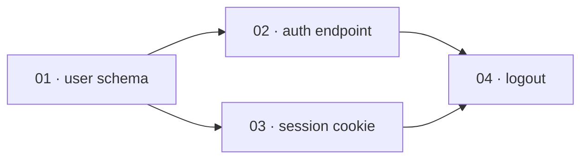

# Plan-file contract

The **logical schema** every superdev slice carries. `/superdev:plan` writes it; `/superdev:implement`
reads it. It is backend-agnostic: the local-file rendering is shown below; issue backends
(`issue-tracker-jira.md`, etc.) map the same fields onto issue bodies, links, and statuses.

## Fields

| Field | Meaning | Consumed by |
|---|---|---|
| `id` | Stable slice identifier — the local backend uses the zero-padded file number (`01`, `02`, …); an issue backend uses the issue key. | DAG ordering, status tracking |
| `title` | Short descriptive name. | humans |
| `depends-on` | List of slice `id`s that must merge before this slice can start. Empty = root. | `/implement` DAG |
| `test-applicability` | `behavior` \| `mechanical` \| `docs`. Drives the warrant gates (see below). | `/implement` |
| `spec` | What this slice delivers end-to-end — the implementer's requirements. Describe behavior and name the specific interface (a function signature, an API endpoint, a CLI command) its tests exercise — not file paths. | `implementer` |
| `acceptance` | Checkable criteria for THIS slice. On a `behavior` slice these name the domain-level failure and boundary cases too — those derivable from the interview without reading the implementation — not just the happy path. Implementation-level edges stay with the implementer and the reviewers, who read code the planner never sees. `commands/plan.md` holds the split with examples. | `slice-reviewer`, `implementer` |
| `status` | Canonical lifecycle `todo` → `in-progress` → `in-review` → `merged` (= done), plus `blocked`. Backends map these onto their real statuses; the ledger is authoritative during a run. | `/implement`, store |

Plus one **global Definition of Done** block: the acceptance criteria for the whole feature. Anchors
`/implement` Phase 0 and the final review.

Both `acceptance` and the DoD state **observable, user-facing behaviour** — not gameable proxy counts
(coverage %, line count, lint score). Behaviour can't be faked without doing the work; a count can. Where
a proxy count appears at all it's a signal a reviewer reads, never a gate an agent optimizes toward (ADR
0002).

**The epic is optional.** A plan with a single slice needs no epic: that slice IS the whole plan, so its
`acceptance` doubles as the global DoD, and the slice is its own scope anchor. A plan with ≥2 slices
always carries a global DoD (the epic) on top of the per-slice `acceptance` fields, as above.

**Parked questions** (optional, epic-only). A load-bearing decision the interview couldn't resolve,
written to the epic the moment it's parked (`cross-exam.md`'s termination rule permits ending an interview
this way). Purely advisory — `/implement` never reads it, nothing gates on it, no new lifecycle status.
Single-slice plans carry no equivalent: an unresolved load-bearing decision there signals the plan isn't
single-slice-simple yet, not something to park (ADR 0005).

**Non-goals** (optional, epic-only). Something deliberately not being built — from the interview's own
scoping, or routed here from a seeded intent's rejected scope (`domain-modeling.md`). Advisory, like
parked questions: `/implement` never reads it. Single-slice plans write no epic, so a deliberate
exclusion there is named in the lone slice's `spec` instead.

## Epic visuals (optional, epic-only)

Two sections `/plan` may add to the epic when the plan's shape defeats a numbered list. Both are for
human readers of the epic; both are **advisory**, exactly like `Parked questions` — `/implement` never
reads them, no review agent gates on them, and neither adds a lifecycle status. Visuals are markdown
only: superdev ships no renderer and writes no HTML artifact (ADR 0009).

**`## Slice graph`** — a mermaid `flowchart LR` of the plan's `depends-on` DAG, one node per slice
labelled `<id> · <title>`, one edge per `depends-on` entry:

````markdown
## Slice graph


````

**`## Touch map`** — a fenced plain-text tree of the files the plan touches, naming the slices that
touch each one and marking every file that slices **able to run in parallel** both edit. It is the
evidence for the dependency order, not an instruction: no slice `spec` gains a file path (the `spec`
field rule and **Negotiable** both still hold), and an implementer that touches a file the map didn't
predict has done nothing wrong.

````markdown
## Touch map

```
src/
  auth/
    login.ts       ← 02
    session.ts     ← 03
    logout.ts      ← 04
  db/schema.ts     ← 01
  index.ts         ← 02, 03   ⚠ parallel, barrel export, both add a line
```

`02` and `03` are the only pair with no dependency path between them, so `index.ts` is the only
collision — every other file is touched by one slice, or by slices the graph already orders.
````

### When to write them

- **Floor.** A plan `/implement` would run at the **`lite` tier** gets neither section, ever — such a
  plan is too small to have a shape worth drawing. The floor *is* the tier boundary; it is not a second
  number to keep in sync.
- Above the floor, write `## Slice graph` when the graph is **not a single chain** — some slice has ≥2
  dependencies, or two slices have no dependency path between them. A chain of any length is a numbered
  list, and drawing it is noise.
- A plan above the floor with no `depends-on` anywhere still earns the graph: a diagram with no edges is
  correct, not empty — it communicates "everything is parallel".
- Above the floor, write `## Touch map` when slices that **can run in parallel** edit a common file.
  With no parallel overlap the map has nothing to report; omit it.
- The two are independent: a plan can warrant one and not the other.
- `/plan` **states the verdict** in one line either way, so the judgment is visible and overridable —
  "7 slices, two parallel branches colliding on `src/index.ts` — writing both sections", or "5 slices,
  straight chain — numbered list is clearer, skipping both".

Single-slice plans carry no equivalent: they write no epic at all, and they are under the floor anyway.
A slice store that renders neither mermaid nor HTML shows the graph as a fenced code block — legible,
unrendered; the touch map is plain text and unaffected.

## `test-applicability` → warrant gates

- `behavior` — implementer does full TDD; **slice-reviewer runs** (correctness + independent
  verification); **simplicity-reviewer runs** (over-engineering).
- `mechanical` — pure move/rename/format: no new test (the existing suite is the net); **both
  per-slice reviews skipped**; correctness is caught by the suite + final review.
- `docs` — documentation only: no test, **reviews skipped**.

## Slice lifecycle & status

`/implement` drives each slice through a canonical lifecycle. Every backend maps these onto its own
statuses — the local file uses them verbatim; an issue tracker maps them to real statuses/transitions
recorded in `issue-tracker.md`:

| Canonical | Entered when |
|---|---|
| `todo` | slice written to the store |
| `in-progress` | an implementer is dispatched for it |
| `in-review` | implementer returned; per-slice review running (**behavior** slices only) |
| `blocked` | implementer reports BLOCKED (only if the tracker has a blocked state) |
| `merged` (done) | merged into the scope branch |

`mechanical`/`docs` slices skip `in-review` (`in-progress` → `merged`). The scope anchor issue moves to
`in-progress` when the run starts. `/superdev:ship` closes it to `done` at the end of the chain.

`/implement` derives an **execution tier** from the loaded slice count (≤3 → `lite`, >3 → `full`) —
never a plan field, never persisted. The **lite** tier has no per-slice review at all, regardless of
`test-applicability`: every slice goes `todo` → `in-progress` → `merged` directly, and a single
whole-scope review substitutes for the per-slice ones. The table above (and the `behavior`-only
`in-review` step) describes the **full** tier.

## Scope anchor

A feature's **scope anchor** is its root. A multi-slice plan's root has slices beneath it; a single-slice
plan's root is its own lone slice — one rule for both shapes, so a single-slice plan needs no special case
(ADR 0017). A consumer that needs a feature's scope-level signal — `/superdev:afk` selecting its next
feature, the status map above writing the anchor's own status — reads the active
`docs/agents/issue-tracker.md`'s own `## Scope anchor`
section rather than assuming any one store's shape — how to recognise one, list the candidates, list the
slices beneath one, and tell that an anchor is itself a slice are backend mechanism, and belong there, not
here.

## Vertical-slice rules (how `/plan` must slice)

- Each slice is a **tracer bullet**: a narrow but COMPLETE path through every layer (schema → API → UI
  → tests), demoable/verifiable on its own.
- Each slice leaves the suite **green on its own**.
- A slice depends on another **only if it cannot be green without it** — keep the graph honest, or you
  serialize work that could run in parallel.
- **Negotiable** — the `spec` states intent and the end-to-end behaviour and leaves the implementer room
  on the *how*; it is a contract of outcomes, not a line-by-line script.
- **Estimable** — a slice a fresh reviewer couldn't size in one pass is too big or too vague: decompose
  it further until each slice is a unit you could gate on its own.

## Local-file rendering

See [`issue-tracker-local.md`](issue-tracker-local.md) for the file layout and per-file format.

## Issue-backend mapping (general)

When the slice store is an issue tracker, each slice is one issue:

- `id` ↔ the issue key/number (record the mapping in the plan or ledger so `depends-on` can reference
  real keys).
- `title` ↔ issue title.
- `depends-on` ↔ the tracker's "is blocked by" link type.
- `spec` ↔ issue description body ("What to build").
- `acceptance` ↔ a checklist in the description (or sub-tasks).
- `test-applicability` ↔ a label.
- `status` ↔ the tracker's status/state; a "ready" label/status marks slices an agent may pick up.
- global DoD ↔ a parent/epic issue, or the first section of the feature epic. A single-slice feature
  skips the epic issue — the lone slice's `acceptance` checklist is the DoD.
- **Parked questions** (optional) ↔ a `## Parked questions` section in the epic issue body. Epic-only —
  absent on single-slice features, same as the epic itself.
- **Non-goals** (optional) ↔ a `## Non-goals` section in the epic issue body, same registration as
  **Parked questions** above. Epic-only, advisory — `/implement` never reads it.
- **Epic visuals** (optional) ↔ `## Slice graph` and `## Touch map` sections in the epic issue body,
  same body-text pattern. Epic-only, advisory, and written only when *When to write them* above says so.

The exact commands and vocabulary live in the active `docs/agents/issue-tracker.md`.

### Assignee — store configuration, not a slice field

Every issue a run creates — the epic and each slice — is assigned to the account named by the
**`Assignee`** setting in the active `docs/agents/issue-tracker.md`: a single store-native identifier (a
login on Forgejo/GitHub, an `accountId` on Jira). It deliberately gains **no row in the *Fields* table
above**. Assignee names who owns work inside a tracker — a property of the store and the run, not of a
slice — and the local-file store has no equivalent, so a schema field would be one that backend could
never honour (ADR 0010).

- **Absent setting** — no `Assignee` line in `issue-tracker.md` → resolve the API token's own identity
  from the store's whoami endpoint and assign that. Every issue-backed repo gets owned issues without
  configuring anything.
- **`Assignee: none`** — create the issues unassigned. A deliberate choice, not a failure: no warning,
  no error.
- **Applied at creation** — the assignee goes in the same create call that already carries the title,
  body, and labels, for the epic and every slice. Never a follow-up pass, so it costs no extra request.
- **A bad assignee must never cost the run its issues** — `/plan` fires every slice create in parallel, so
  one misconfigured `Assignee` can't be allowed to fail every create in the batch. A store rejects an
  unassignable configuration one of two ways, and each has its own recovery:
  - **The create itself is rejected because of the assignee** (the account doesn't exist, or can't be
    assigned on this repo) — retry that one create **once, without the assignee**, so the issue still
    exists; report it **once** for the whole run.
  - **The create succeeds but the assignee comes back empty** (the token lacks the permission to assign,
    and drops it silently) — read the assignee back from the response the create already returned; if
    it's empty while one was configured, report it **once** for the whole run.

  Either way every issue is still created, and nothing is retried more than that one time or rolled back.

The field name, identifier format, which of the two shapes a given backend fails with, and the whoami
endpoint are per-backend and live in the active `docs/agents/issue-tracker.md`. The local-file store has
no assignee: `issue-tracker-local.md` neither carries the setting nor honours it.
